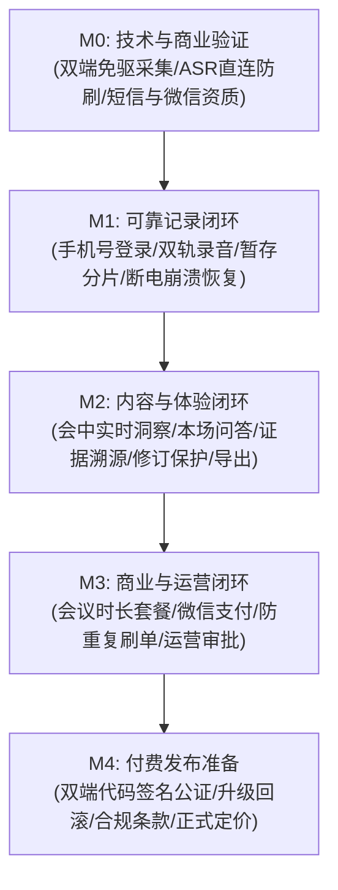

# 听序（Tingxu） - 技术文档中心

**最后更新：** 2026-10-30  
**文档版本：** v0.2（对应 Notion 规划最新评审基准）  
**文档中心维护者：** 听序研发团队（PM / 架构师 / 文档工程）

---

## 项目概述

当前开发记录：[计划014：混音说话人与ASR稳定性](./plans/014-mixed-audio-speakers-and-asr-stability.md)、[实施基线与门禁](./research/014-asr-baseline-and-decisions.md)。字幕协议与时序已有实现；双轨与真实声纹模型仍需后续门禁，不代表整项计划已完成。

**听序（Tingxu / 代号 tingxu-desktop）** 是一款运行在 Windows 与 macOS 桌面的极简无感、开源优先的 AI 会议助手（类似 Granola / 讯飞听见）。  
无需向 Teams、腾讯会议、飞书等软件添加任何虚拟参会机器人，通过纯本地免驱双轨音频捕获、流式 ASR 直连、用户自备 Key（BYOK - 支持阿里云百炼、DeepSeek、自定义 OpenAI 兼容端点及本地离线模型）与本地优先（Local-First）存储体系，为个人办公用户（优先服务产品经理与项目经理）提供会中实时字幕、增量结构化洞察、本场问答追溯以及会后高精纪要与待办提取。

**核心价值：** 
- **极简无感**：无需会议机器人入会，不侵入会议链接，零驱动门槛即可双轨物理内录。
- **边开会边整理**：提供“实时洞察看板 + 本场问答 + 逐字稿”双栏工作台，动态跟踪议题、决定与待办，且具备人工确认保护与修订审核机制。
- **本地优先与隐私主权**：会议音频、逐字稿、截图与纪要默认 100% 保存在本机 SQLite，零数据强制上云，彻底消除敏感会议内容泄露疑虑。
- **单机 BYOK 开箱即用与云端双模自由**：开源免费，用户自备 Key 直连大模型与语音识别，无需起后端服务；未来支持可选的云端托管增援模式（针对无 Key 用户或团队统一采购）。

**目标用户：** 中国大陆个人办公人群，优先服务高频线上会议的产品经理（PM）、项目经理（PMP/Scrum Master）及团队骨干。

---

## 目录结构

```
docs/
├── README.md                          # 本文件 - 文档索引与全景导航
├── plans/                             # 开发执行计划与迭代记录（支持 project-workflow）
├── specs/                             # 核心规格文档（必读）
│   ├── PRD.md                         # 产品需求文档（v0.2 完整版，含 FR/BR/NFR/AC）
│   ├── SAD.md                         # 软件架构设计文档（Tauri 2+Rust+React+Local-First+Gateway）
│   ├── BILLING-AND-OPS.md             # 计费规则、运营后台与权益管理规范
│   └── UIUX-DESIGN-SPEC.md            # UI/UX 设计系统与交互规范（Impeccable 标准）
├── guides/                            # 开发指南与工程规范
│   ├── AI-DEVELOPMENT-GUIDE.md        # AI 辅助开发指南（严格 TDD 流程与编码规范）
│   └── TESTING-GUIDE.md               # 测试规范与验收用例矩阵
├── modules/                           # 核心系统模块详细设计
│   ├── audio-capture.md               # 模块一：双轨无感音频采集（WASAPI Loopback / ScreenCaptureKit）
│   ├── asr-streaming.md               # 模块二：流式 ASR 直连与通道管理（阿里云百炼 / 讯飞）
│   ├── insight-engine.md              # 模块三：会中实时洞察与本场问答流水线
│   ├── local-store.md                 # 模块四：Local-First 存储与全文检索（SQLite + FTS5）
│   ├── ai-gateway.md                  # 模块五：自建 AI Gateway 网关与模型熔断容灾
│   └── admin-backend.md               # 模块六：商业化控制面与运营管理后台（NestJS + 微信支付）
├── database/                          # 数据库设计文档
│   ├── SCHEMA.md                      # 客户端 SQLite 与服务端 PostgreSQL 完整数据字典
│   └── MIGRATIONS.md                  # 数据库版本迁移与容灾恢复规范
└── api/                               # 接口契约
    └── api-spec.md                    # RESTful 控制面接口、AI Gateway 契约与 WebSocket ASR 协议
```

---

## 必读文档（按优先级排序）

### 1. 规格文档（specs/）

| 文档 | 说明 | 何时查阅 |
|------|------|----------|
| [PRD.md](./specs/PRD.md) | 产品需求与验收规范（FR-001~015、BR-001~014、AC-001~016） | 明确功能范围、业务边界与验收门槛时 |
| [SAD.md](./specs/SAD.md) | 系统架构设计（Tauri 2 客户端、Rust 采集层、AI Gateway 与服务端） | 开发任何功能前必须通读 |
| [BILLING-AND-OPS.md](./specs/BILLING-AND-OPS.md) | 会议时长套餐、双配额记账、微信支付、运营审批与审计体系 | 涉及计费、登录鉴权、套餐发放与后台开发时 |

### 2. 开发指南（guides/）

| 文档 | 说明 | 何时查阅 |
|------|------|----------|
| [AI-DEVELOPMENT-GUIDE.md](./guides/AI-DEVELOPMENT-GUIDE.md) | AI 辅助开发指南（严格 TDD 红-绿-重构规范、Rust/TS/SQL 约定） | 开始编写代码前（AI 协作基石） |
| [TESTING-GUIDE.md](./guides/TESTING-GUIDE.md) | 双端权限、音频漂移、弱网容灾、并发防刷与断网恢复测试指南 | 编写与运行单元测试、集成测试时 |

### 3. 核心模块文档（modules/）

| 模块文档 | 负责领域 | 涉及关键技术 |
|----------|----------|--------------|
| [audio-capture.md](./modules/audio-capture.md) | 双轨物理音频捕获与免驱内录 | Rust, WASAPI Loopback, ScreenCaptureKit, RingBuffer |
| [asr-streaming.md](./modules/asr-streaming.md) | 流式 ASR 直连、临时凭据与通道标记 | WebSocket, 阿里百炼, 讯飞 ASR, 临时 STS / 受控中继 |
| [insight-engine.md](./modules/insight-engine.md) | 会中实时洞察、主动问答与人工保护机制 | 滑动窗口 (Sliding Window), 增量补丁, 本地快照 |
| [local-store.md](./modules/local-store.md) | 本地优先嵌入式存储与秒级全文检索 | SQLite, Rusqlite, SQLCipher, SQLite FTS5 |
| [ai-gateway.md](./modules/ai-gateway.md) | 商业 Prompt 代理、多模型智能熔断 | DeepSeek-V3, Qwen-2.5-72B, 熔断限流, 零日志留存 |
| [admin-backend.md](./modules/admin-backend.md) | 用户鉴权、时长权益账、微信支付与审批后台 | Node.js (NestJS), PostgreSQL, 微信商户 Native 支付 |

---

## 快速查找

### 按任务类型

| 我要做什么 | 应该看什么 |
|------------|------------|
| 了解产品功能边界、会中新交互与验收条件 | [PRD.md](./specs/PRD.md) |
| 了解系统整体分层、数据流与 ADR 架构决策 | [SAD.md](./specs/SAD.md) |
| 了解套餐定价逻辑、用户时长权益与后台审批 | [BILLING-AND-OPS.md](./specs/BILLING-AND-OPS.md) |
| 新建功能开发或修复 Bug（严格遵守 TDD 流程） | [AI-DEVELOPMENT-GUIDE.md](./guides/AI-DEVELOPMENT-GUIDE.md) |
| 查看本地客户端表结构或服务端数据字典 | [SCHEMA.md](./database/SCHEMA.md) |
| 查看前后端接口契约、错误码与协议定义 | [api-spec.md](./api/api-spec.md) |

### 按技术栈

| 技术栈 | 相关文档与模块 |
|--------|----------------|
| **Rust 底层核心** | [SAD.md](./specs/SAD.md) / [audio-capture.md](./modules/audio-capture.md) / [local-store.md](./modules/local-store.md) |
| **Tauri 2 + React + Tailwind** | [SAD.md](./specs/SAD.md) / [PRD.md](./specs/PRD.md) / [insight-engine.md](./modules/insight-engine.md) |
| **NestJS + PostgreSQL 服务端** | [admin-backend.md](./modules/admin-backend.md) / [BILLING-AND-OPS.md](./specs/BILLING-AND-OPS.md) |
| **大模型与 ASR 管道** | [asr-streaming.md](./modules/asr-streaming.md) / [ai-gateway.md](./modules/ai-gateway.md) |

---

## 技术栈选型矩阵

| 层次/模块 | 生产选型 | 关键选型理由 |
| --- | --- | --- |
| **桌面客户端框架** | **Tauri 2.0 (Rust + React + TailwindCSS)** | 常驻内存仅 30-50MB（极致轻量），Rust 原生操控底层音频与 C-FFI API 最为稳健 |
| **Windows 音频采集** | **WASAPI Loopback (原生)** | 零虚拟声卡驱动门槛，系统原生捕获当前扬声器混音音频流 |
| **macOS 音频采集** | **ScreenCaptureKit (macOS 13+)** | 官方免驱内录音频通道，无感捕获系统音频（与 Granola / Limitless 同款机制） |
| **流式 ASR 引擎** | **阿里百炼 / 讯飞流式 ASR (WebSocket)** | MVP 阶段零 GPU 运维成本，按量计费，中文及专业术语识别率行业顶尖 |
| **大模型整理引擎** | **DeepSeek-V3 + Qwen-2.5-72B** | 中文逻辑理解与结构化能力顶尖，性价比极高，自建 AI Gateway 实施双模型容灾 |
| **客户端本地存储** | **SQLite (Rusqlite + FTS5 + 可选 SQLCipher)** | Local-First 架构，秒级全文检索，保障数据主权与物理断网可用 |
| **商业化控制面** | **Node.js (NestJS) + PostgreSQL** | 模块化单体架构，强事务 ACID 保障交易与权益账一致性，易于对接微信支付 |

---

## 阶段实施路线图（M0 ~ M4）

听序采用质量门槛驱动的交付顺序（不虚设固定工期，以依赖关系与验收标准推进）：



---

## AI 研发工作原则

在听序代码库中使用 AI 辅助开发时，必须遵守以下四项核心铁律：

1. **Local-First 数据安全铁律**：严禁将任何用户会议标题、正文、逐字稿、截图、音频片段写入云端业务数据库或反向代理日志；服务端只保留无敏感信息的账单、任务 ID 与脱敏计量。
2. **凭据与私钥物理隔离**：大模型 API Key、微信商户私钥、阿里云短信密钥严禁下发至桌面客户端，所有高价值调用必须经由自建 AI Gateway 或控制面。
3. **不可覆盖的人工编辑保护**：会中被用户确认、编辑或锁定的洞察卡片，即使后续 ASR 产生新文本冲突，也不得原地覆盖，必须生成“待复核版本”并保留历史证据溯源。
4. **严格 TDD 测试驱动**：所有核心逻辑（尤其是音频环形缓冲、增量滑动窗口、版本补丁合并、权益预占结算）必须先编写测试用例（Red），再实现代码（Green），最后重构（Refactor）。
