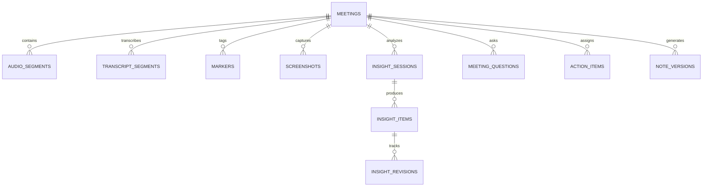
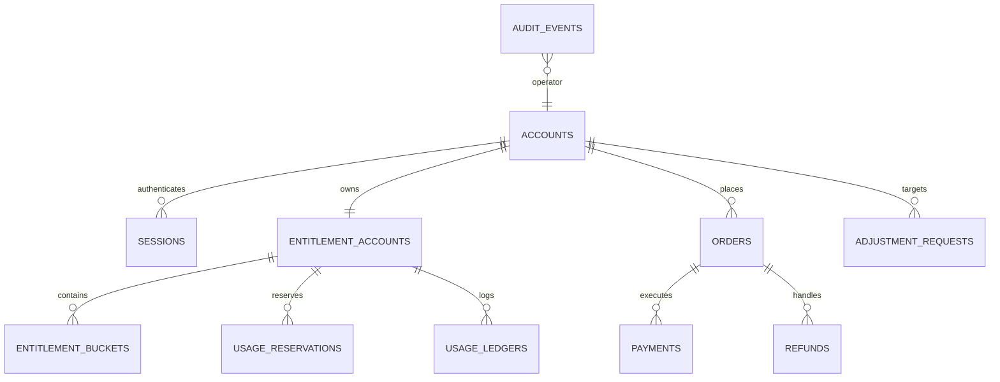

# 数据库设计与 Schema 规范（SCHEMA）

**项目名称：** 听序（Tingxu）  
**文档版本：** v0.2  
**最后更新：** 2026-10-30  
**适用范围：** 桌面客户端本地 SQLite 数据库与云端控制面 PostgreSQL 数据库  

---

## 1. 架构总览

听序采用 **Local-First（本地优先）** 架构。系统数据被清晰划分为两大物理边界：
1. **客户端本地 SQLite（承载内容主权）**：存放会议元数据、双轨音频分片索引、逐字稿分段、FTS5 全文索引、增量洞察、人工手记、截图引用与会后多版本纪要。云端不备份此部分内容。
2. **云端业务 PostgreSQL（承载交易与凭据）**：存放用户账号、短信防刷记录、套餐时长批次、任务预占流水、微信订单、退款流水与审计日志。不存储任何会议正文或标题。

---

## 2. 客户端本地数据库 Schema (SQLite 3)

本地数据库位于用户操作系统应用隔离目录下（例如 macOS: `~/Library/Application Support/tingxu/user_{account_hash}/tingxu.db`）。推荐集成 `SQLCipher` 透明加密或采用系统凭据库保护。



### 2.1 会议主表 `meetings`
```sql
CREATE TABLE meetings (
    local_id TEXT PRIMARY KEY,               -- 本地生成的 UUIDv4
    account_id TEXT NOT NULL,                -- 所属云端账号 ID（用于多账号隔离）
    title TEXT NOT NULL,                     -- 会议标题（默认：未命名会议_YYYYMMDD_HHmm）
    start_time INTEGER NOT NULL,             -- 会议开始时间戳（Unix 毫秒）
    end_time INTEGER,                        -- 会议结束时间戳（Unix 毫秒）
    duration_seconds INTEGER DEFAULT 0,      -- 录制有效秒数（剔除暂停时间）
    status TEXT NOT NULL,                    -- RECORDING, PAUSED, FINALIZED, FAILED
    source_type TEXT NOT NULL,               -- LIVE_RECORDING, FILE_IMPORT
    audio_path TEXT,                         -- 录音存储的本地根目录
    created_at INTEGER NOT NULL,             -- 记录创建时间（Unix 毫秒）
    updated_at INTEGER NOT NULL
);
CREATE INDEX idx_meetings_account_time ON meetings(account_id, start_time DESC);
```

### 2.2 音频分片索引表 `audio_segments`
```sql
CREATE TABLE audio_segments (
    segment_id TEXT PRIMARY KEY,             -- 分片唯一 ID
    meeting_id TEXT NOT NULL REFERENCES meetings(local_id) ON DELETE CASCADE,
    channel_type TEXT NOT NULL,              -- MIC（本地我方）, SYSTEM（远端对方）
    start_ms INTEGER NOT NULL,               -- 相对于会议起始的毫秒偏移
    end_ms INTEGER NOT NULL,                 -- 结束毫秒偏移
    file_path TEXT NOT NULL,                 -- 本地分片音频存储绝对路径（.pcm / .wav）
    file_size_bytes INTEGER NOT NULL,        -- 文件大小
    checksum TEXT NOT NULL,                  -- SHA256 校验和（用于断电崩溃恢复核验）
    is_flushed INTEGER DEFAULT 1,            -- 是否已完整写入物理磁盘（0/1）
    created_at INTEGER NOT NULL
);
CREATE INDEX idx_audio_segments_meeting ON audio_segments(meeting_id, start_ms);
```

### 2.3 逐字稿切片与全文索引 `transcript_segments` & FTS5
```sql
CREATE TABLE transcript_segments (
    segment_id TEXT PRIMARY KEY,             -- 逐字稿切片 ID
    meeting_id TEXT NOT NULL REFERENCES meetings(local_id) ON DELETE CASCADE,
    channel_type TEXT NOT NULL,              -- MIC（我方）, SYSTEM（远端）
    speaker_tag TEXT,                        -- 说话人标记（默认：我 / 对方）
    text_content TEXT NOT NULL,              -- 识别文字正文
    start_ms INTEGER NOT NULL,               -- 对应音频起始时间
    end_ms INTEGER NOT NULL,                 -- 对应音频结束时间
    is_final INTEGER DEFAULT 1,              -- 是否为已确定稳定文本（0=临时中间词, 1=终态词）
    revision INTEGER DEFAULT 1,              -- 文本更正版本号
    created_at INTEGER NOT NULL
);
CREATE INDEX idx_transcript_meeting_time ON transcript_segments(meeting_id, start_ms);

-- SQLite FTS5 全文检索虚表
CREATE VIRTUAL TABLE transcript_fts USING fts5(
    segment_id UNINDEXED,
    meeting_id UNINDEXED,
    text_content,
    tokenize = 'unicode61'                  -- 支持中文与英文混合分词分块
);

-- 自动同步触发器：插入或更新时同步 FTS 虚表
CREATE TRIGGER trg_transcript_fts_insert AFTER INSERT ON transcript_segments
WHEN new.is_final = 1 BEGIN
    INSERT INTO transcript_fts(segment_id, meeting_id, text_content)
    VALUES (new.segment_id, new.meeting_id, new.text_content);
END;
```

### 2.4 会中实时洞察会话与条目表 `insight_items` & `insight_revisions`
```sql
CREATE TABLE insight_items (
    stable_id TEXT PRIMARY KEY,              -- 卡片稳定 ID
    meeting_id TEXT NOT NULL REFERENCES meetings(local_id) ON DELETE CASCADE,
    topic_id TEXT NOT NULL,                  -- 所属议题标识
    kind TEXT NOT NULL,                      -- DECISION（决定）, ACTION（行动项）, TOPIC（讨论要点）, AI_SUGGESTION（AI建议）
    title TEXT NOT NULL,                     -- 卡片要点简述
    body TEXT,                               -- 详细内容
    evidence_refs TEXT NOT NULL,             -- JSON 数组：[{"segmentId":"...","startMs":12000,"quote":"..."}]
    revision INTEGER DEFAULT 1,              -- 当前版本号
    is_confirmed INTEGER DEFAULT 0,          -- 用户是否已点击确认（0/1）
    is_pinned INTEGER DEFAULT 0,             -- 是否置顶固定（0/1）
    is_ignored INTEGER DEFAULT 0,            -- 是否已忽略（0/1）
    human_revision INTEGER DEFAULT 0,        -- 人工手动编辑次数
    created_at INTEGER NOT NULL,
    updated_at INTEGER NOT NULL
);
CREATE INDEX idx_insight_items_meeting ON insight_items(meeting_id, is_ignored);

-- 人工保护与修订历史表
CREATE TABLE insight_revisions (
    revision_id TEXT PRIMARY KEY,
    item_stable_id TEXT NOT NULL REFERENCES insight_items(stable_id) ON DELETE CASCADE,
    old_version INTEGER NOT NULL,
    new_version INTEGER NOT NULL,
    proposed_title TEXT NOT NULL,            -- 冲突发生时模型建议的新标题
    proposed_body TEXT,                      -- 模型建议的新正文
    reason TEXT NOT NULL,                    -- 修订原因（如：后文发言更正了上线排期）
    evidence_refs TEXT NOT NULL,             -- 新增的证据引用 JSON
    status TEXT NOT NULL,                    -- PENDING_REVIEW（待审核）, ADOPTED（已采用）, REJECTED（已驳回）
    created_at INTEGER NOT NULL
);
```

### 2.5 待办事项表 `action_items` 与纪要版本表 `note_versions`
```sql
CREATE TABLE action_items (
    action_id TEXT PRIMARY KEY,
    meeting_id TEXT NOT NULL REFERENCES meetings(local_id) ON DELETE CASCADE,
    content TEXT NOT NULL,                   -- 待办内容描述
    assignee TEXT,                           -- 负责人（可为空或“待确认”）
    due_date TEXT,                           -- 截止日期（如：2026-11-05 或“待确认”）
    is_completed INTEGER DEFAULT 0,          -- 是否已完成（0/1）
    evidence_ref TEXT,                       -- JSON 格式来源证据引用
    created_at INTEGER NOT NULL,
    updated_at INTEGER NOT NULL
);

CREATE TABLE note_versions (
    version_id TEXT PRIMARY KEY,
    meeting_id TEXT NOT NULL REFERENCES meetings(local_id) ON DELETE CASCADE,
    version_number INTEGER NOT NULL,         -- 版本递增序号
    generated_type TEXT NOT NULL,            -- AI_FULL_SUMMARY, HUMAN_EDITED
    content_markdown TEXT NOT NULL,          -- 结构化纪要 Markdown 正文
    model_version TEXT,                      -- 生成使用的大模型名称与版本
    source_transcript_version INTEGER,       -- 对应的最新逐字稿版本
    created_at INTEGER NOT NULL
);
```

---

## 3. 云端 PostgreSQL 业务数据库 Schema

云端数据库主要处理账户体系、套餐时长与微信支付交易。



### 3.1 账号与会话表 `accounts` & `sessions`
```sql
CREATE TABLE accounts (
    id UUID PRIMARY KEY DEFAULT gen_random_uuid(),
    phone_hash VARCHAR(64) NOT NULL UNIQUE,  -- 手机号加盐哈希（防彩虹表破解）
    phone_masked VARCHAR(20) NOT NULL,       -- 脱敏手机号（例如：138****0000，用于后台展示）
    status VARCHAR(20) NOT NULL DEFAULT 'ACTIVE', -- ACTIVE, SUSPENDED
    created_at TIMESTAMPTZ NOT NULL DEFAULT NOW(),
    updated_at TIMESTAMPTZ NOT NULL DEFAULT NOW()
);

CREATE TABLE sessions (
    id UUID PRIMARY KEY DEFAULT gen_random_uuid(),
    account_id UUID NOT NULL REFERENCES accounts(id) ON DELETE CASCADE,
    device_fingerprint VARCHAR(128) NOT NULL,
    platform VARCHAR(20) NOT NULL,           -- WINDOWS, MACOS
    token_hash VARCHAR(64) NOT NULL UNIQUE,
    expires_at TIMESTAMPTZ NOT NULL,
    created_at TIMESTAMPTZ NOT NULL DEFAULT NOW()
);
CREATE INDEX idx_sessions_account_exp ON sessions(account_id, expires_at);
```

### 3.2 权益账户、时长批次与不可篡改账本
```sql
-- 权益聚合主表
CREATE TABLE entitlement_accounts (
    account_id UUID PRIMARY KEY REFERENCES accounts(id) ON DELETE CASCADE,
    total_available_sec INT NOT NULL DEFAULT 0, -- 当前可用会议时长（秒），通过批次累加
    version INT NOT NULL DEFAULT 1,          -- 乐观锁版本号
    updated_at TIMESTAMPTZ NOT NULL DEFAULT NOW()
);

-- 时长权益批次表（按来源与有效期分池）
CREATE TABLE entitlement_buckets (
    id UUID PRIMARY KEY DEFAULT gen_random_uuid(),
    account_id UUID NOT NULL REFERENCES accounts(id) ON DELETE CASCADE,
    grant_type VARCHAR(32) NOT NULL,         -- PURCHASED（购买）, COMPENSATION（运营补偿）, PROMOTION（促销）
    source_order_id UUID,                    -- 关联的购买订单 ID
    granted_sec INT NOT NULL,                -- 初始发放秒数
    remaining_sec INT NOT NULL,              -- 剩余可用秒数
    expires_at TIMESTAMPTZ,                  -- 到期时间戳（NULL 代表长期有效）
    created_at TIMESTAMPTZ NOT NULL DEFAULT NOW()
);
CREATE INDEX idx_buckets_account_exp ON entitlement_buckets(account_id, expires_at);

-- 任务预占表（防并发超支）
CREATE TABLE usage_reservations (
    id UUID PRIMARY KEY DEFAULT gen_random_uuid(),
    account_id UUID NOT NULL REFERENCES accounts(id) ON DELETE CASCADE,
    task_id VARCHAR(64) NOT NULL UNIQUE,     -- 幂等任务唯一 ID
    reserved_sec INT NOT NULL,               -- 预占秒数
    status VARCHAR(20) NOT NULL,             -- PENDING, SETTLED, RELEASED
    expires_at TIMESTAMPTZ NOT NULL,         -- 租约心跳截止时间
    created_at TIMESTAMPTZ NOT NULL DEFAULT NOW()
);

-- 不可篡改用量账本（Append-only，严禁物理删除或修改）
CREATE TABLE usage_ledgers (
    id UUID PRIMARY KEY DEFAULT gen_random_uuid(),
    account_id UUID NOT NULL REFERENCES accounts(id),
    task_id VARCHAR(64),
    event_type VARCHAR(32) NOT NULL,         -- RESERVE, SETTLE, RELEASE, GRANT, EXPIRE, REVERSE
    delta_sec INT NOT NULL,                  -- 时长变动秒数（正数为增加，负数为扣减）
    balance_sec INT NOT NULL,                -- 变动后的可用结余
    operator_id UUID,                        -- 触发操作的操作人（用户本人或后台运营）
    reason TEXT,                             -- 变动理由
    created_at TIMESTAMPTZ NOT NULL DEFAULT NOW()
);
CREATE INDEX idx_usage_ledgers_account ON usage_ledgers(account_id, created_at DESC);
```

### 3.3 商业订单与微信支付交易表 `orders` & `payments`
```sql
CREATE TABLE orders (
    id UUID PRIMARY KEY DEFAULT gen_random_uuid(),
    order_no VARCHAR(64) NOT NULL UNIQUE,    -- 听序内部业务订单号
    account_id UUID NOT NULL REFERENCES accounts(id),
    plan_id VARCHAR(32) NOT NULL,            -- 购买的套餐 ID
    plan_title VARCHAR(64) NOT NULL,         -- 套餐名称快照
    granted_duration_sec INT NOT NULL,       -- 购买时长（秒）快照
    original_price_cents INT NOT NULL,       -- 原价（分）
    discount_cents INT NOT NULL DEFAULT 0,   -- 优惠抵扣（分）
    actual_price_cents INT NOT NULL,         -- 实际应付（分）
    status VARCHAR(20) NOT NULL,             -- PENDING_PAYMENT, PAID, CANCELLED, REFUNDED
    created_at TIMESTAMPTZ NOT NULL DEFAULT NOW(),
    updated_at TIMESTAMPTZ NOT NULL DEFAULT NOW()
);

CREATE TABLE payments (
    id UUID PRIMARY KEY DEFAULT gen_random_uuid(),
    order_id UUID NOT NULL REFERENCES orders(id),
    payment_channel VARCHAR(32) NOT NULL,    -- WECHAT_PAY_NATIVE
    transaction_id VARCHAR(64) UNIQUE,       -- 微信支付商户交易号
    amount_cents INT NOT NULL,               -- 实际支付金额（分）
    pay_time TIMESTAMPTZ,                    -- 微信支付成功时间
    callback_payload JSONB,                  -- 微信回调报文存证（脱敏后）
    created_at TIMESTAMPTZ NOT NULL DEFAULT NOW()
);
```

### 3.4 运营审批与审计日志表 `adjustment_requests` & `audit_events`
```sql
CREATE TABLE adjustment_requests (
    id UUID PRIMARY KEY DEFAULT gen_random_uuid(),
    target_account_id UUID NOT NULL REFERENCES accounts(id),
    applicant_id UUID NOT NULL,              -- 申请运营人员 ID
    grant_type VARCHAR(32) NOT NULL,         -- DURATION_MINUTES, EXTEND_DAYS
    grant_value INT NOT NULL,                -- 赠送时长分钟数或天数
    reason TEXT NOT NULL,                    -- 补偿原因（必填）
    status VARCHAR(20) NOT NULL DEFAULT 'PENDING', -- PENDING, APPROVED, REJECTED
    approver_id UUID,                        -- 审批人（所有者）ID
    approved_at TIMESTAMPTZ,
    idempotency_key VARCHAR(64) NOT NULL UNIQUE, -- 幂等键
    created_at TIMESTAMPTZ NOT NULL DEFAULT NOW()
);

CREATE TABLE audit_events (
    id UUID PRIMARY KEY DEFAULT gen_random_uuid(),
    operator_id UUID NOT NULL,
    action_type VARCHAR(64) NOT NULL,        -- LOGIN, APPROVE_ADJUSTMENT, REFUND_SUBMIT, PLAN_UPDATE
    resource_type VARCHAR(32) NOT NULL,
    resource_id VARCHAR(64),
    ip_address VARCHAR(45),
    before_state JSONB,
    after_state JSONB,
    created_at TIMESTAMPTZ NOT NULL DEFAULT NOW()
);
```
