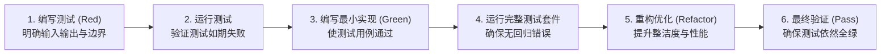

# AI 辅助开发指南（AI-DEVELOPMENT-GUIDE）

**项目名称：** 听序（Tingxu）  
**文档版本：** v0.2  
**最后更新：** 2026-10-30  
**适用范围：** 所有参与听序开发的 AI 智能体（如 Antigravity / Claude Code）及结对研发工程师  

---

## 1. 概述与开发铁律

本文档规定了 AI 辅助编写、测试、重构与审查听序（`tingxu`）代码时必须遵循的核心流程与工程规范。听序是一个包含系统底层 C-FFI / Rust 媒体采集、本地嵌入式数据库、Tauri 跨平台前端以及高可靠金融交易云端控制面的复合工程。

### 必须严格遵守的四大铁律
1. **Local-First 数据安全铁律**：严禁在服务端业务数据库、链路追踪（Trace）、Sentry 错误堆栈或日志文件中写入任何用户的会议标题、逐字稿正文、音频文件、截图、或完整手机号。
2. **私钥凭据物理隔离**：大模型 API Key、微信商户 APIv3 私钥、阿里云 AccessKey 绝对不允许下发至客户端代码或打包至客户端安装包中；所有模型调用必须通过自建 AI Gateway 转发。
3. **已确认人工稿保护铁律**：会中被用户打上“已确认”或人工修改过的洞察卡片，在遇到新 ASR 文本冲突时，必须通过 `Revision` 创建并列的“待复核”草稿，严禁原地静默覆盖用户劳动成果。
4. **强制 TDD 测试驱动**：所有核心业务逻辑（尤其是音频环形缓冲、增量切片算法、版本补丁合并、微信支付防重放与时长预占扣减）必须遵循“红 $\rightarrow$ 绿 $\rightarrow$ 重构”的 TDD 流程。

---

## 2. TDD（测试驱动开发）执行流程

所有代码编写必须按严格的六步循环执行，**绝不允许在没有失败测试用例的前提下直接编写业务实现**：



### 开发步骤规范：
- **Step 1: 需求对齐**：首先查阅 [PRD.md](../specs/PRD.md) 与对应 [modules/](../modules/) 文档，确认输入、输出、边界异常以及业务不变量。
- **Step 2: 编写测试（Red）**：针对该需求编写单元测试或集成测试。测试应涵盖正常路径、边界值（如空文本、超长音频帧、零配额、网络断开）以及异常抛出。
- **Step 3: 验证失败**：运行测试命令，确认测试因为未实现而报错，排除虚假成功的假象。
- **Step 4: 编写实现（Green）**：编写最精简、高内聚的代码，直至测试全部通过。
- **Step 5: 重构代码（Refactor）**：消除代码异味（Code Smell），提取公共模块，增加必要的代码注释与安全检查。
- **Step 6: 回归运行**：运行所有相关测试套件，确保覆盖率达到要求且无破坏性改动。

---

## 3. 多语言与技术栈代码规范

### 3.1 Rust 代码规范（Tauri 底层与媒体服务）
- **内存安全与线程并发**：
  - 音频采样使用无锁双缓冲或 `crossbeam-channel` / `Arc<Mutex<RingBuffer>>`，避免在音频高频采集回调线程中申请大块堆内存或执行阻塞式 I/O。
  - 所有可能产生 Panic 的操作（如 `.unwrap()`、`.expect()`）严禁在生产运行时直接裸调，必须转换为 `Result<T, AudioCaptureError>` 并优雅处理。
- **C-FFI 与原生交互**：
  - macOS Objective-C / Swift 绑定与 Windows WASAPI 调用的 `unsafe` 代码块必须最小化并附带详细的 SAFETY 保证注释。
- **Rusqlite 操作**：
  - 必须使用参数化查询，杜绝任何形式的 SQL 字符串拼接；
  - 批量写入逐字稿切片必须显式开启 SQLite 事务（`Transaction`），避免每个单句插入触发单次磁盘 fsync 导致性能骤降。

### 3.2 TypeScript / React 代码规范（桌面客户端前端）
- **类型系统严格性**：
  - 全项目开启严格模式（`strict: true`），严禁使用 `any`，必须为所有 Props、State、API 响应定义精确的 TypeScript interface 或 type。
- **组件拆分与渲染优化**：
  - 逐字稿实时打字机组件与实时洞察卡片列表必须使用 `React.memo` 或虚拟滚动（Virtual List），防止每回传一个流式文字触发整页重新渲染。
  - 会中状态使用轻量状态库（如 Zustand），实现精确选择器订阅，降低渲染级联。
- **样式与规范**：
  - 统一采用 TailwindCSS 工具类进行布局；
  - 状态与色彩遵循三色规范：主操作使用品牌蓝，可用/正常使用绿色，需人工复核/警告使用橙色，错误/危险使用红色；所有状态必须同时有文字表述。

### 3.3 Node.js / NestJS 代码规范（商业化控制面与 AI Gateway）
- **分层架构与依赖注入**：
  - 遵循 Controller $\rightarrow$ Service $\rightarrow$ Repository 经典三层结构；
  - 接口输入必须使用 `class-validator` 装饰器定义严格的 DTO（Data Transfer Object）并在全局启用 `ValidationPipe({ whitelist: true })`，剔除未经定义的恶意字段。
- **事务与数据库操作**：
  - 微信支付回调、套餐时长增加、时长扣减预占必须封装在 PostgreSQL 数据库事务（`QueryRunner.startTransaction()`）中，确保强一致性。
- **脱敏日志规范**：
  - 编写全局拦截器与日志适配器，针对带有 `authorization`、`code`、`phone`、`content`、`transcript` 等关键词的字段自动打码脱敏（如 `138****0000`）。

---

## 4. 关键模块编码指南

### 4.1 增量洞察合并引擎（Sliding Window）
1. 客户端调度器监听稳定文本流，仅当稳定字数增量 $\ge 300$ 字或 VAD 静默时长 $> 45$ 秒时才组装 Prompt 并推送至 AI Gateway。
2. 调度时必须传入：
   - 当前讨论的已有议题状态摘要（结构化 JSON）；
   - 本次新增的稳定文本；
   - 有界的前情上下文（最多 3 句滑动锚点）。
3. 响应解析必须进行 JSON Schema 强校验；解析失败时重试或忽略，严禁向界面直接抛出裸的大模型 Markdown 代码块。

### 4.2 微信支付 Native 扫码与防重放
1. 微信支付成功通知回调必须采用微信官方 v3 验签机制，严禁跳过签名验证。
2. 回调处理的第一行代码必须使用订单号加锁或在事务中检查：
   ```typescript
   if (order.status === OrderStatus.PAID) {
     return { code: 'SUCCESS', message: 'OK' }; // 幂等返回，防止重复发权益
   }
   ```
3. 权益时长到账必须在同一事务中写入 `entitlement_buckets` 和不可覆盖的流水记录 `usage_ledgers`。

---

## 5. Git 工作流与提交约定

### 5.1 分支管理
- `main`：生产稳定发布分支，禁止直接推送代码，必须通过 Pull Request 并在全套自动化测试通过后合并；
- `develop`：主开发分支；
- `feature/{issue-id}-{module-name}`：新功能开发分支；
- `fix/{issue-id}-{bug-name}`：缺陷修复分支。

### 5.2 Conventional Commits 提交信息规范
每次 git commit 必须使用如下格式：
```
<type>(<scope>): <subject>

[optional body]

[optional footer(s)]
```
- **Type 允许值**：
  - `feat`: 新增功能（如 `feat(capture): support screen capture kit on macos`）
  - `fix`: 修复缺陷（如 `fix(sqlite): resolve transaction lock in batch insert`）
  - `test`: 增加或修改测试用例（如 `test(billing): add idempotency test for wechat callback`）
  - `docs`: 文档变更（如 `docs(sad): update adr-001 with relay architecture`）
  - `refactor`: 重构代码（无功能增减）
  - `perf`: 性能调优
  - `chore`: 构建配置、依赖更新等

---

## 6. 禁止的反模式（Anti-Patterns）

在编写代码时，**绝对禁止**以下做法：
1. ❌ **禁止在客户端硬编码大模型 API Key**：任何包含 `sk-...` 的代码合并将被 CI 静态检测扫描直接拦截。
2. ❌ **禁止直接使用 `DELETE` 语句物理清除用户云端账单**：所有账务流水必须是追加型（Append-only），错误发放只允许通过补录冲正（Reverse）单据解决。
3. ❌ **禁止在音频采集回调中执行网络请求或文件锁等待**：音频采集线程优先级极高，若发生等待会导致系统音频缓冲区溢出并引发刺耳爆音。
4. ❌ **禁止在模型响应后原地更新已确认的人工卡片**：如果用户已点击确认，必须生成 `RevisionReviewRequired` 待审核事件。
5. ❌ **禁止向大模型上下文直接注入未经校验的用户输入控制指令**：防止 Prompt 注入攻击修改系统既定指令。
