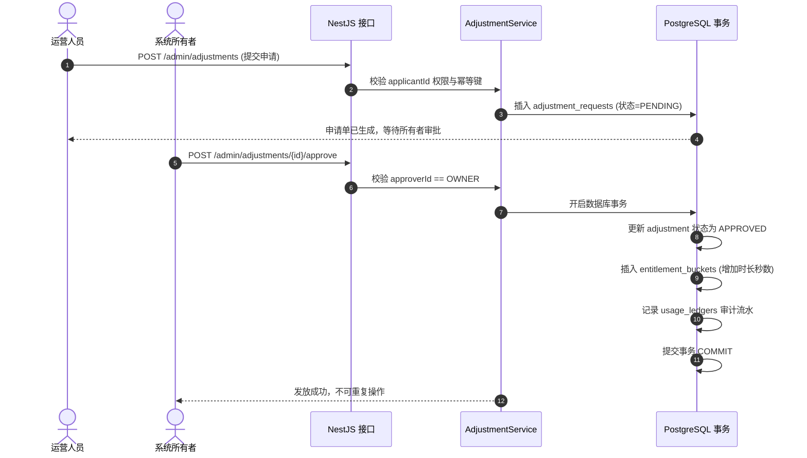

# 模块设计：商业控制面与运营后台（admin-backend）

**模块名称：** `admin-backend`  
**技术选型：** Node.js (NestJS) + PostgreSQL + React Web 运营后台  
**负责人：** 听序后端与运营研发组  
**最后更新：** 2026-10-30  

---

## 1. 模块定位与职责

`admin-backend` 负责承载听序的商业变现闭环与运营治理能力。

- **商业控制面 API**：提供手机验证码鉴权、会议时长套餐购买、微信 Native 扫码支付与异步验签回调处理；
- **时长权益账核心**：基于 PostgreSQL 强事务管理每个账户的时长批次（Buckets）、任务预占（Reservations）与不可篡改审计流水（Ledgers）；
- **独立 Web 运营后台**：供系统所有者（Owner）与授权运营人员进行指标统计核阅、异常补偿申请与严格的审批流。

---

## 2. 核心架构与业务模块

```
server/
├── src/
│   ├── modules/
│   │   ├── auth/           # 手机号验证码、JWT 会话管理
│   │   ├── entitlements/   # 时长权益聚合根、预占与核销服务
│   │   ├── orders/         # 订单生命周期管理、微信 Native 支付网关
│   │   ├── adjustments/    # 运营时长补偿申请与所有者审批工作流
│   │   ├── metrics/        # 脱敏聚合统计与用量成本对账
│   │   └── audit/          # 操作审计拦截器与日志写入
│   └── common/             # 全局错误过滤器、DTO 校验管道、脱敏日志适配器
```

---

## 3. 运营审批核心代码时序



- **数据隐私铁律落实**：后台服务在 Controller 层与 Service 层全面实行脱敏策略；所有接口返回中严格抹除手机号中间四位，且数据库物理字段严禁设计任何存放用户会议逐字稿或标题的列。
