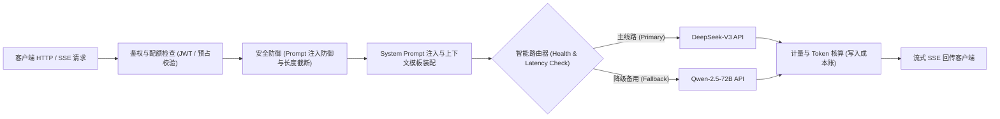

# 模块设计：自建 AI Gateway 网关（ai-gateway）

**模块名称：** `ai-gateway`  
**部署形态：** 独立高性能服务端中继网关（基于 Rust / Node.js 高并发 I/O 构建）  
**负责人：** 听序后端与基础设施架构组  
**最后更新：** 2026-10-30  

---

## 1. 模块定位与职责

`ai-gateway` 是听序连接桌面客户端与各大商业大模型服务商的咽喉要道。

- **高价值资产收归管辖**：企业商业 Prompts 与大模型 API Key 严格保存在网关内存中，不对客户端暴露；
- **智能熔断与灾备路由**：以 DeepSeek-V3 为主模型，当响应时延超过阈值（如 $> 15s$）或发生 429 限流时，自动降级至热备 Qwen-2.5-72B；
- **内存级零留存（Zero-Content Retention）**：请求与响应正文仅在内存中流经并实时通过 SSE 推送给客户端，严禁写入任何磁盘数据库或中间代理请求体日志。

---

## 2. 网关内部请求管道（Pipeline）

---

## 3. 容灾与熔断设计（Circuit Breaker）

- **熔断策略**：统计最近 20 次请求的失败率与超时率。若失败率 $> 20\%$，熔断器进入半开（Half-Open）状态，将新流量自动导流给 Qwen-2.5。
- **重试幂等性**：使用请求头中的 `X-Idempotency-Key` 进行会话去重，避免因弱网重传导致服务商多次重复扣取 Token 费用。
