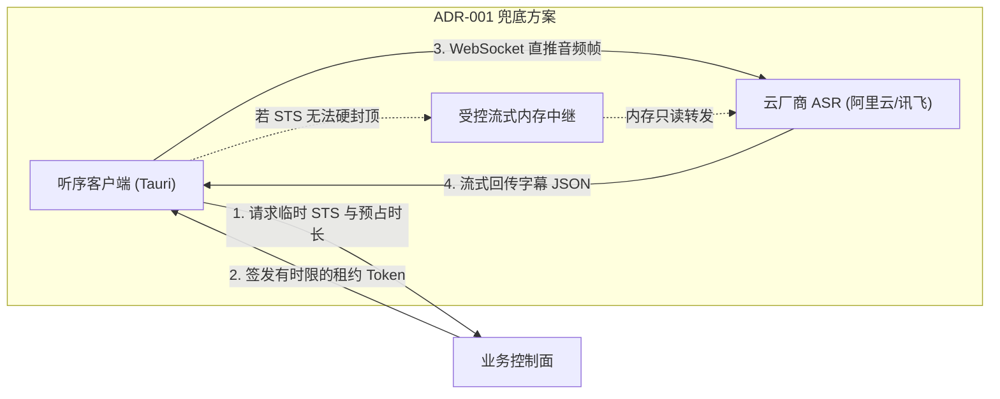

# 模块设计：流式 ASR 直连与通道管理（asr-streaming）

**模块名称：** `asr-streaming`  
**代码路径：** `src-tauri/src/asr/`  
**负责人：** 听序核心系统研发组  
**最后更新：** 2026-10-30  

---

## 1. 模块定位与职责

### 014 当前实施状态（2026-11-02）

当前运行链路为 `src/audio/realStreamingAsrClient.ts` → `gateway/src/asr/streamingAsrServer.ts` → Paraformer realtime。本文原有多厂商、STS与恢复描述为设计目标，不代表本轮已完成。014已实现字幕事件关联、120ms合并刷新、final立即显示及有界结束；**独立双轨、真实CAM++/重叠检测尚未交付**。

- v2事件保留旧INTERIM.text/FINAL.sentence，并附带taskId、utteranceId、revision、source和句时间；有时间字信息以words透传。缺时间不伪造精确片段。
- 每连接是独立任务，客户端按来源绑定task；final不可被迟到interim回退，重复final幂等。当前source仍为mic，不能把已有混合音频宣称独立来源。
- 草稿仅展示，不写入正式记录或触发洞察；较稳定前缀只是显示启发式，final可以全部纠正。首条草稿即时、后续120ms合并；final取消待刷新timer。
- final先提交正文，声纹队列按句顺序异步补标签，失败/积压降级未确定。单次推理2秒超时熔断本会话，不继续堆积不可取消的原生调用。
- 暂停/结束冻结计时和新音频，FINISH→finish-task→尾句→FINISHED后才取历史/纪要快照。网关5秒、客户端6秒有界等待；超时不把草稿升级final。设备停止另设内存门禁，旧设备未释放不能恢复新会话。
- 上游错误不转发原始错误正文；解析失败不输出供应商响应内容。
- 真机补充：ASR、洞察、问答统一遵循既有网关地址配置；设置草稿失焦校验后应用。音频启动恢复suspended AudioContext，并以3秒超时清理失败设备，不能仅以“连接成功”判断麦克风已经产生PCM。

验证与剩余准入条件见[计划014](../plans/014-mixed-audio-speakers-and-asr-stability.md)和[实施记录](../research/014-asr-baseline-and-decisions.md)。

`asr-streaming` 模块负责将底层采集的标准 PCM 音频帧高效推送至云端 ASR 引擎，并接收低延迟的流式转写结果。

- **多供应商抽象适配**：抽象统一的 `AsrEngine` Trait，无缝对接阿里云百炼（DashScope ASR）与科大讯飞流式 ASR。
- **物理音轨标记映射**：在推送协议或结果解析中显式携带 `channel: MIC | SYSTEM`，将文字精确打标为“我方发言”或“对方发言”。
- **暂态词与稳定词分层**：
  - Interim Text（中间临时词）：用于驱动 UI 打字机实时动效；
  - Finalized Text（稳定终态词）：持久化存入 SQLite，并触发后续增量洞察引擎。

---

## 2. ASR 直连与防刷架构（响应 ADR-001）

### 2.1 会话管理与重连策略
- **帧打包参数**：音频帧按 100ms（3200 字节，16kHz 16-bit 单声道）打包分片发送。
- **心跳续约**：客户端与控制面保持 15 分钟一次的租约心跳上报；若配额耗尽，控制面主动通知 ASR 断开或客户端静默暂停云推送。
- **断线指数退避**：当网络波动导致 WebSocket 断开时，采用 $1s, 2s, 4s, 8s$（最多重试 5 次）指数退避重连；断网期间本地音频正常落盘，恢复后自动同步。
