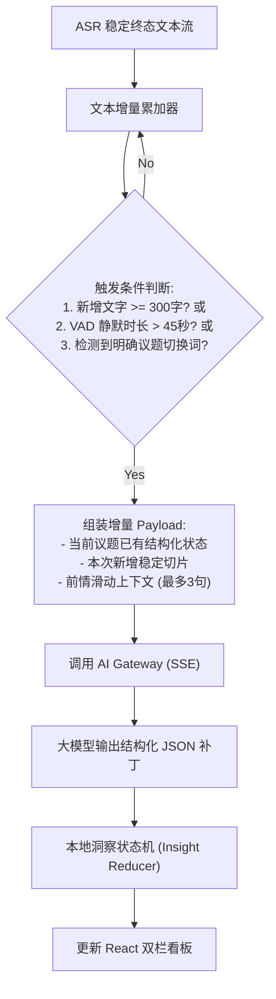
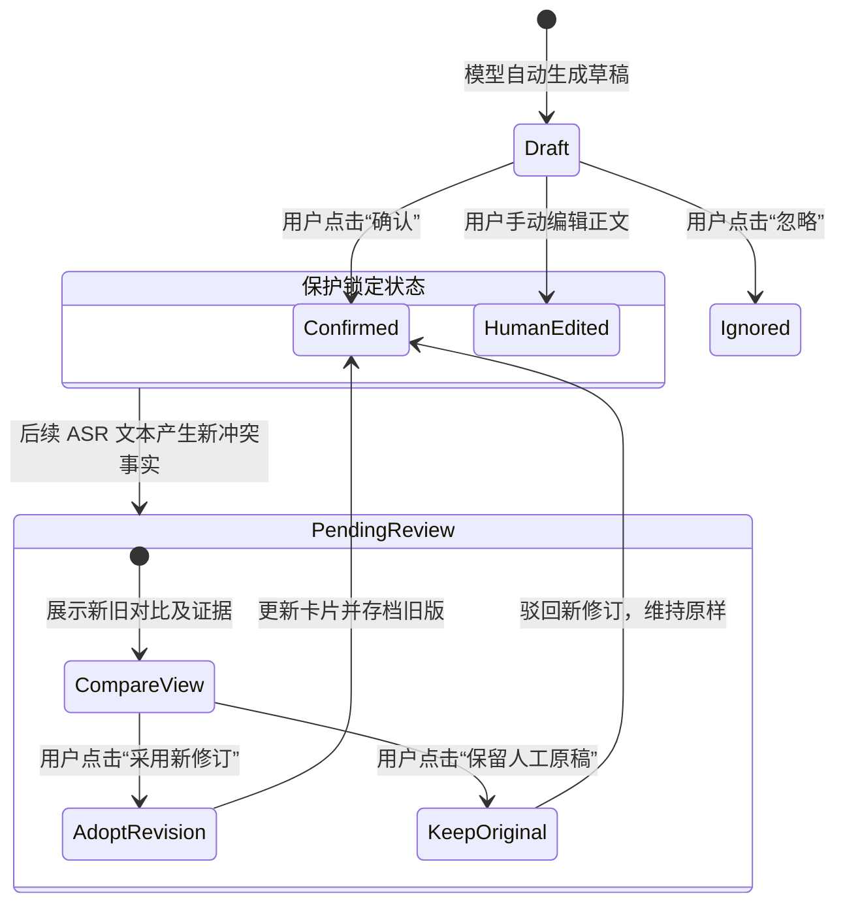

# 模块设计：会中实时洞察与本场问答（insight-engine）

**模块名称：** `insight-engine`  
**代码路径：** `src-tauri/src/insight/` 及 `src/components/insights/`  
**负责人：** 听序核心系统与 AI 算法研发组  
**最后更新：** 2026-10-30  

---

## 1. 模块定位与职责

`insight-engine` 是听序 v0.2 的核心灵魂模块。它打破传统会议工具“会后等待整场跑大模型”的呆板模式，在会议进行中实现“边开会、边理解、边整理”。

- **增量滑动窗口切片（Sliding Window）**：实时监测稳定新增逐字稿，按议题与文本阈值驱动大模型提取结构化看板；
- **同议题增量合并**：避免每隔几分钟生成一份新的小结卡片，而是动态维护当前议题的讨论要点、明确决定与行动项；
- **核心人工保护机制**：用户确认或编辑过的卡片具备防篡改锁；后续发生讨论冲突时生成并列的“修订待复核”卡片；
- **本场专属“AI 问一问”**：基于提问时刻本场已固化的稳定逐字稿提供快速解答，并给出精准段落证据。

---

## 2. 增量滑动窗口调度算法



---

## 3. 结构化增量补丁格式

AI Gateway 流式回传严格契约的 JSON 增量补丁，客户端在本地根据 `action` 驱动状态更新：

```typescript
export interface InsightPatch {
  action: 'CREATE_TOPIC' | 'UPDATE_TOPIC' | 'APPEND_DECISION' | 'REVISE_ITEM' | 'RETRACT_ITEM';
  topicId: string;
  item?: {
    stableId: string;
    kind: 'DECISION' | 'ACTION' | 'TOPIC_POINT' | 'AI_SUGGESTION';
    title: string;
    body?: string;
    evidenceRefs: Array<{
      segmentId: string;
      startMs: number;
      quote: string;
    }>;
  };
  revisionReason?: string; // 修订理由（如："参会人否定了此前的周五交付方案"）
}
```

---

## 4. 人工保护与修订审核状态机（BR-005）



- **证据高亮联动**：用户点击卡片右下角的“查看依据”按钮，右侧逐字稿自动平滑滚动并高亮该句原文，保留当前光标与阅读位置，不突兀拉拽窗口。
