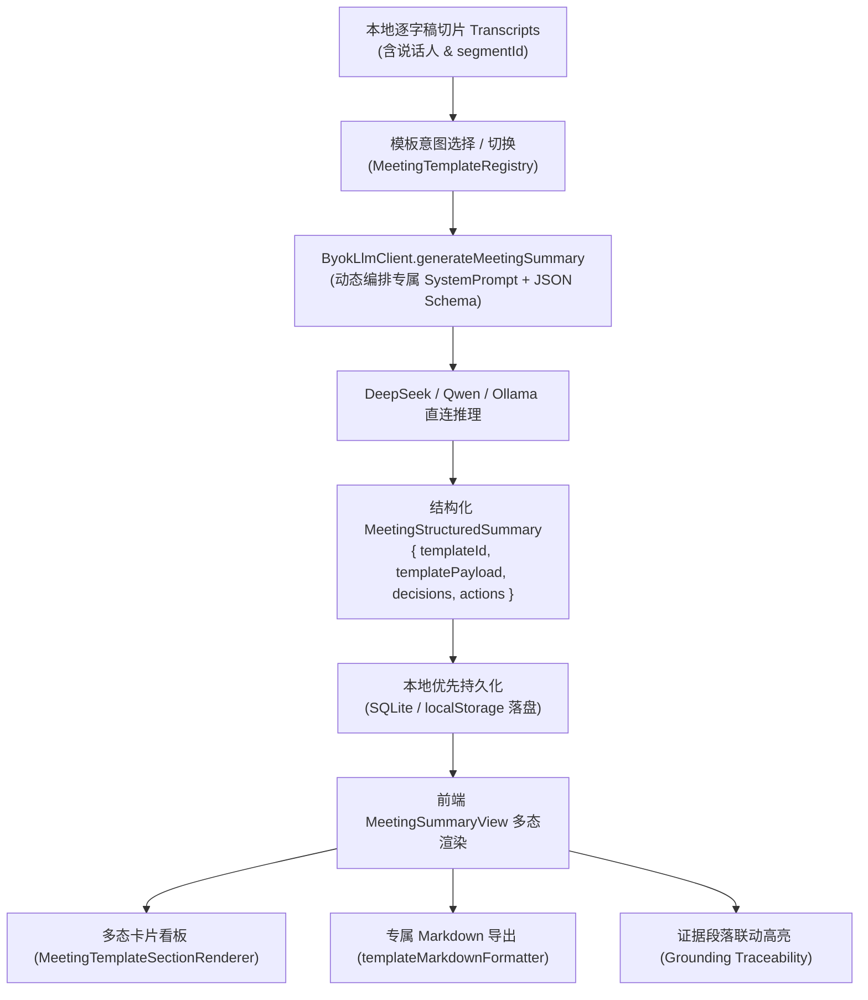

# 多角色多场景智能会议纪要模板引擎（Multi-Template Meeting Summary Engine）

**生效版本：** 0.3.8+  
**模块定位：** 客户端会后结构化纪要萃取、模板元数据管理与多态卡片渲染引擎。  
**关联代码：**
- `src/types/template.ts`（10 大模板类型与多态 Payload 契约）
- `src/engine/templateRegistry.ts`（模板元数据注册表）
- `src/api/byokLlmClient.ts`（模板专属 Prompt 编排与大模型 Schema 结构化抽取）
- `src/utils/templateMarkdownFormatter.ts`（多模板专属 GitHub Flavored Markdown 导出引擎）
- `src/components/views/MeetingTemplateSectionRenderer.tsx`（多态卡片交互组件）
- `src/components/views/MeetingSummaryView.tsx`（会后总结报告全屏视图）

---

## 1. 业务背景与设计哲学

传统智能会议纪要普遍采用单一的“主旨概述 + 决策结论 + 待办任务”粗放流水账，面对学生、商务销售、记者、非虚构创作者、招聘官、项目经理和行政秘书等多工种诉求时，存在严重的“信息颗粒度不匹配、思考框架脱节”问题。

听序（Tingxu）借鉴经典管理学、认知心理学与新闻传播学方法论，系统性内置并落地了 **10 大角色场景模板体系**：

| 模板标识 (ID) | 模板名称 | 典型角色 | 核心设计哲学与特色 |
|---|---|---|---|
| `academic` | **高校会议纪要** | 学生 / 科研人员 | **学术争鸣与实验闭环**：细分课题进展、导师专业纠偏/推荐文献、未解争议与实验截稿节点。 |
| `drucker` | **德鲁克有效会议模板** | 职场管理层 / 高管 | **成果与决策导向**：会议只为贡献而开，严禁流水账；重点提取决策、保留分歧与单一责任人 (DRI) 矩阵。 |
| `cornell` | **康奈尔笔记模板** | 学生 / 受训者 | **空间三区与知识内化**：经典 5R 笔记法，左侧提示线索 (Cues) + 右侧详尽主笔记 (Notes) + 底部浓缩精粹 (Summary)。 |
| `client_visit` | **客户拜访纪要模板** | 商务销售 (BD) / 售前 | **商业机会与决策链透视**：挖掘客户核心业务痛点、记录方案异议、梳理 BANT 要素与 Next Steps。 |
| `interview_analysis` | **采访内容分析** | 记者 / 深度媒体 / 用研 | **原汁原味与态度洞察**：高保真采撷核心金句 (Quotes)、分议题归纳、典型故事还原与采访者观察。 |
| `mcphee` | **麦克菲整理法模板** | 深度撰稿人 / 策划 | **非线性卡片重组**：打破时间先后，提炼核心矛盾 (The Hook)，将跨时间段材料重构为逻辑主题簇。 |
| `hiring_interview` | **面试复盘纪要** | 招聘HR / 用人主管 | **多维量化与录用决策**：硬技能/软技能/文化契合评估、STAR 高光实绩证据链、短板风险与定级定薪建议。 |
| `grai` | **GRAI 模板** | 项目经理 / Leader | **因果推导与复盘闭环**：Goal目标回顾 $\rightarrow$ Result结果比对 $\rightarrow$ Analysis根因分析 $\rightarrow$ Insight规律与行动。 |
| `executive_brief` | **精简版纪要模板** | 职场通用 / 全员通报 | **30秒极速阅读**：一句话全局主旨 (TL;DR)、Top 3-5 核心决议与紧凑待办清单。 |
| `role_summary` | **角色总结纪要** | 秘书 / 跨部门协调员 | **发言人维度的立场解构**：以部门/参会人为核心单元，分别梳理汇报要点、诉求阻碍与跨角色协同依赖。 |

---

## 2. 核心架构与数据流图



---

## 3. 强类型 Schema 契约

在 `src/types/template.ts` 中针对每个模板定义了严格的 Payload 接口。例如 **德鲁克有效会议模板**：

```typescript
export interface DruckerSummaryPayload {
  corePurpose: string; // 会议核心目的与业务贡献
  decisions: Array<{
    title: string;
    content: string;
    evidenceSegmentId?: string; // 关联原逐字稿段落
  }>;
  dissentingViewsAndRisks: Array<{
    point: string;
    reason: string;
    evidenceSegmentId?: string;
  }>;
  accountabilityMatrix: Array<{
    action: string;
    owner: string; // 单一直接责任人 (DRI)
    deliverable: string;
    deadline: string;
    evidenceSegmentId?: string;
  }>;
}
```

所有的事实依据均挂载 `evidenceSegmentId`，前端点击「查看依据」即可触发右侧逐字稿平滑居中滚动与呼吸焦点高亮（`setSelectedSegmentId` + `setRightPanelTab('transcripts')`）。

---

## 4. 铁律遵循与安全合规

1. **Zero-Content 数据主权**：
   模板参数、大模型提取 Prompt 与多态 Payload 均在本地沙箱中流转与持久化，绝不上报用户会议原文至业务服务器。
2. **不可覆盖的人工编辑保护（Human Protection）**：
   在会后切换模板或重新生成时，`useMeetingStore.regenerateSummaryWithTemplate` 会自动扫描历史中已被用户手动确认（`isConfirmed: true`）的决策与待办项，优先保留并在新模板生成后予以合并置顶，绝不抹除用户的手工劳动。
3. **QA 门禁合规**：
   模板下拉选择器（`summary-page-template-selector`）、切换按钮（`summary-page-btn-switch-template`）以及各多态区块（`summary-page-template-content-<id>`）均 100% 覆盖符合 AGENTS.md 规范的 `data-testid`。
