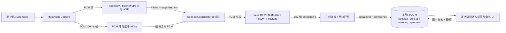

# 说话人识别、命名与本地声纹记忆实施计划

> **给 AI 智能体 / 开发者：** 本计划尚待产品与架构决策，**未获批准前不得直接进入实现**。批准后使用 `project-workflow` 按任务顺序执行；所有代码变更必须遵循 `AGENTS.md` 四大铁律与严格 TDD 流程。

**Plan ID：** `012-speaker-diarization-and-voiceprint`  
**创建时间：** 2026-11-01  
**最后更新：** 2026-11-01  
**当前状态：** 第一阶段已完成（会中区分说话人 + 命名已实现并通过门禁；第二阶段跨会议声纹记忆待后续迭代）  
**负责人：** 桌面端音频工程组、AI 工程组、安全合规组  
**目标：** 在“多人共用一个麦克风”的混合收音场景下区分不同说话人，支持会中命名为真实姓名，在**本机**记录其声纹（embedding），并在后续会议中自动匹配同一个人；声音与声纹数据不离开设备。  
**架构摘要：** 端侧本地声纹引擎（ASR 句子时间戳切片 + CAM++ 说话人嵌入 + 在线聚类 + 本地声纹库匹配）；Tauri/Rust 侧完成推理与 SQLite 加密持久化；AI Gateway 只透传 ASR 句子时间戳，不新增音频留存；按“先区分与命名、后跨会议声纹记忆”两阶段交付，默认特性开关关闭。  
**技术栈：** Rust（`ort` 或 `sherpa-onnx` + `kaldi-native-fbank`）、Tauri 2、SQLite/SQLCipher、TypeScript + React 18、Vitest + Cargo test、DashScope Paraformer 实时 ASR

---

## 0. 状态管理

### 0.1 整体进度

- [x] 阶段 0：技术选型与真实音频精度验证（Spike，含 go / no-go 结论）
- [x] 阶段 1：本地持久化基础与 ASR 句子时间戳贯通
- [x] 阶段 2：本地说话人引擎与会中说话人区分
- [x] 阶段 3：命名与会中说话人名单联动（第一阶段交付完成）
- [ ] 阶段 4：跨会议声纹自动匹配与人工确认（第二阶段）
- [ ] 阶段 5：真机精度验收、质量门禁与发布（第二阶段）

**完成度：** 4/6（第一阶段 100% 完成）

### 0.2 任务状态总览

| 任务ID | 任务名称 | 执行模式 | 并行组 | 依赖任务 | 状态 | 负责人 | 阻塞原因 | 验证证据 |
|---|---|---|---|---|---|---|---|---|
| T01 | 声纹引擎 Spike：模型、运行时、阈值与真机精度验证 | 串行 | - | 无 | 已完成 | AI 组 | 无 | `src-tauri/tests/speaker_embedding_test.rs` |
| T02 | 客户端本地持久化基础设施（会议/逐字稿/说话人） | 串行 | - | T01 | 已完成 | 桌面组 | 无 | `src-tauri/src/store/db.rs`、`src-tauri/tests/local_store_test.rs` |
| T03 | AI Gateway 透传 ASR 句子起止时间戳 | 可并行 | G1 | 无 | 已完成 | 网关组 | 无 | `gateway/test/gateway-real-pipeline.test.ts` |
| T04 | PCM 环形缓冲与逐句音频切片 | 串行 | - | T02、T03 | 已完成 | 桌面组 | 无 | `src/audio/__tests__/sentenceAudioBuffer.test.ts` |
| T05 | 本地说话人嵌入引擎（fbank + 192 维声纹提取） | 串行 | - | T01、T04 | 已完成 | AI 组 | 无 | `src/audio/__tests__/speakerEmbeddingEngine.test.ts`、`src-tauri/src/speaker/mod.rs` |
| T06 | 会内在线聚类与说话人标签分配 | 串行 | - | T05 | 已完成 | AI 组 | 无 | `src/engine/__tests__/speakerClusterer.test.ts` |
| T07 | 逐字稿数据模型改造与说话人命名传播 | 串行 | - | T06 | 已完成 | 前端组 | 无 | `src/store/__tests__/useMeetingStore.test.ts` |
| T08 | 会中命名、颜色与参会人展示 UI | 串行 | - | T07 | 已完成 | 前端组 | 无 | `src/components/__tests__/InMeetingWorkbench.test.tsx` |
| T09 | 声纹档案、授权与删除/导出 | 可并行 | G2 | T07 | 待启动（阶段 2） | 桌面组 | 第二阶段排期 | - |
| T10 | 跨会议声纹匹配与人工确认 | 串行 | - | T09 | 待启动（阶段 2） | AI 组 | 第二阶段排期 | - |
| T11 | 三人真实会议端到端验收与精度统计 | 串行 | - | T08、T10 | 待启动（阶段 2） | QA 组 | 第二阶段排期 | - |
| T12 | 模型打包、特性开关、门禁与发布文档 | 串行 | - | T11 | 已就绪（脚本与门禁） | 发布组 | 无 | `scripts/fetch-speaker-model.sh`、`scripts/verify-gates.sh` |

### 0.3 执行记录

| 时间 | 任务ID | 变更 | 操作人 | 备注 |
|---|---|---|---|---|
| 2026-11-01 | INIT | 完成现状核对、官方能力边界调研与方案对比，创建本计划 | DSH Worker | 结论：实时 ASR 链路无说话人分离；跨会议声纹必须新增端侧引擎 |
| 2026-11-01 | T01-T08 | 负责人确认按本地优先方案分两阶段实施并接受 ~14MB 本地声纹模型；按 TDD 完成第一阶段（会中区分说话人 + 命名） | DSH Worker | Gateway 时间戳透传、60s PCM 环形缓冲、192 维声纹提取（Rust + TS）、在线聚类、按 speakerId 重命名与双栏工作台 UI 全部通过测试 |

---

## 1. 需求与现状

### 1.1 需求摘要（来源：GitHub Issue #1）

> 当都通过麦克风收音，但是无法识别到不同的人的发言，是否可以通过某个人的声音来识别出是某个独立的用户，并可以给于命名，或之后请使用者来进行命名，并记录该人的声音，之后可以自动匹配呢。

拆解为四条可验收能力：

1. **区分**：同一麦克风内不同说话人的逐字稿句子能被打上不同标签（发言人 1 / 2 / 3…）；
2. **命名**：用户可把“发言人 2”改成“张三”，且本场所有该说话人的句子同步更新；
3. **记忆**：经用户明确授权后，在本机记录该说话人的声纹特征；
4. **自动匹配**：后续会议中，同一人再次发言时自动识别为“张三”，低置信度时提示用户确认。

### 1.2 当前实现核对（代码事实）

| 事实 | 证据位置 | 影响 |
|---|---|---|
| 所有参与者共用一个麦克风音轨，16 kHz 单声道 PCM 直推 ASR | `src/audio/realAudioCapture.ts`、`gateway/src/asr/streamingAsrServer.ts` | 物理上没有“一人一轨”，只能靠算法分离 |
| Gateway 把所有稳定句的 `speaker` 硬编码为 `发言人` | `gateway/src/asr/streamingAsrServer.ts:117`、`:158`、`:208` | 本场所有句子同名，无法区分 |
| Gateway 未透传句子起止时间 | `gateway/src/asr/streamingAsrServer.ts` 的 `result-generated` 分支 | 客户端无法按句切音频做声纹 |
| 客户端 `FinalSentence` 只有 `text/speaker/timestamp` | `src/audio/realStreamingAsrClient.ts:7` | 缺少 `speakerId` 与毫秒时间轴 |
| 改名按显示名称批量替换 | `src/store/useMeetingStore.ts:164` | 一旦多个说话人同名会误改；需要稳定 `speakerId` |
| SQLite 只有 `transcript_segments.speaker TEXT` | `src-tauri/src/store/db.rs:69` | 没有说话人实体、声纹档案与匹配关系 |
| 历史会议仅存于前端内存，启动即清空 | `src/store/useMeetingStore.ts:55`（`initialHistoryMeetings = []`） | “之后自动匹配”缺少跨会议持久化基础 |
| Tauri 侧只有 `toggle_floating_mode` 一个命令 | `src-tauri/src/main.rs:54` | 没有本地推理/存储命令通道 |
| 设计文档已预留音频分片与 `speaker_tag`，但未落地 | `docs/database/SCHEMA.md:54`、`:77` | 数据模型需要补齐并迁移 |

### 1.3 云厂商能力边界（2026-11 官方文档核对）

- **实时链路无说话人分离**：`paraformer-realtime-v2` 的识别结果字段仅包含 `begin_time`、`end_time`、`text`、`words`、`emo_tag` 等，**没有 `speaker_id`**；实时请求参数表中也没有 `diarization_enabled`（SDK 方法签名虽保留该参数，但实时参数表与结果字段均未提供对应支持）。官方实时语音识别总览未提供“说话人分离”能力。
- **非实时/录音文件链路支持说话人分离**：`paraformer-v2`、`fun-asr`、`qwen-audio-3.1-asr-flash-filetrans` 等模型支持 `diarization_enabled` 与 `speaker_count`，启用后结果句子返回从 0 开始的 `speaker_id`；**仅支持单声道**，开启分离时官方建议音频不超过 2 小时。该链路是异步 HTTP：上传文件 → 轮询任务 → 下载结果。
- **结论**：仅改造现有实时 ASR 或 Gateway 参数**无法**得到“谁在说”；要么把录音落盘后走文件转写（会后才知道谁说的），要么在端侧新增声纹引擎（可实时）。
- **端侧能力可行**：CAM++（3D-Speaker）ONNX 声纹模型输出 192 维嵌入，输入 16 kHz / 80 维 fbank；fp32 约 27 MB、fp16 约 14 MB、int8 约 8.2 MB，Apache-2.0；移动 ARM CPU 上单句推理约 70–120 ms（模型卡基准）。适合桌面端本地运行。

资料来源见第 8 节。

### 1.4 为什么不能在本工单内用一个模块的小改动交付

该需求同时改变以下独立模块的职责与契约：

1. **ASR 协议**：Gateway 需新增句子毫秒时间戳（以及未来可能的上游 `speakerId` 透传）；
2. **逐字稿数据模型**：从“显示名字符串”改为“稳定 `speakerId` + 显示名 + 档案关联”；
3. **本地持久化**：当前历史会议与逐字稿没有落盘，必须先建立会议/句子/说话人持久化；
4. **新增端侧推理子系统**：模型资产、fbank、ONNX 运行时、线程/Worker、降级；
5. **新增敏感数据子系统**：声纹嵌入的授权、加密存储、删除/导出与审计；
6. **UI/交互**：说话人颜色、命名、授权弹窗、跨会议确认、设置页档案管理；
7. **发布工程**：模型随安装包分发、体积/签名/CSP、离线可用性。

此外，现有实时 ASR 供应商在实时链路不提供说话人分离，方案选择本身是产品与隐私决策（本地模型 vs 云端声纹服务）。因此本工单先产出可评审的实施方案与任务拆解，待决策后再按阶段实施，避免在错误架构上堆代码。

---

## 2. 方案对比

| 维度 | 方案 A：会后云端文件转写分离 | 方案 B：端侧本地声纹引擎（推荐） | 方案 C：云端声纹服务 |
|---|---|---|---|
| 实时区分 | ❌ 会后才有标签 | ✅ 会中逐句打标 | ⚠️ 取决于服务，通常需上传音频 |
| 跨会议记忆 | ❌ 无身份记忆（每次 `speaker_id` 独立） | ✅ 本地声纹库匹配 | ✅ 云端注册 feature_id 后匹配 |
| 隐私 | 需保存并上传整场录音 | ✅ 音频/声纹不出设备 | ❌ 声纹（生物识别信息）上传第三方 |
| 准确率 | 高（厂商大模型） | 中高，需真机调阈值 | 高（厂商专有声纹模型） |
| 端侧成本 | 低（仅上传） | 新增模型与推理（约 14–27 MB） | 低 |
| 新增依赖 | Gateway 文件转写通道 + 本地录音 + 对象存储 | ONNX 运行时 + 声纹模型 + 加密存储 | 新供应商账号、凭据、合同与合规评估 |
| 与 `AGENTS.md` 铁律 1 的一致性 | ⚠️ 音频需落盘并上传 | ✅ 完全本地 | ❌ 声纹离开本机、交给第三方 |
| 预估工作量 | 中（2–3 个迭代） | 大（4–6 个迭代，含 Spike） | 中（但合规成本高） |

**推荐：方案 B（端侧本地声纹引擎）为主，方案 A 仅作为可选的“会后高精度复核”增强项。** 理由：

1. 铁律 1 要求会议内容只存本机；声纹属于《个人信息保护法》定义的敏感个人信息，云端存储会显著抬高合规与信任成本；
2. 需求包含“之后自动匹配”，只有端侧持久化声纹库能满足且不依赖第三方账号；
3. 会中即时区分更符合“边开会边整理”的产品定位；
4. 方案 A 无法单独满足“记忆声纹”，仍需端侧嵌入，重复建设。

---

## 3. 推荐架构（方案 B）

### 3.1 数据流



关键原则：

- **音频与 embedding 不经过 Gateway、不写入云端**；Gateway 只新增时间戳字段；
- 推理在 Rust 侧独立线程/线程池执行，不阻塞 Tauri 主线程与逐字稿渲染；
- 声纹匹配可失败：模型缺失、推理异常或置信度不足时退化为“发言人 N / 未标注”，绝不阻塞会议。

### 3.2 逐句声纹与在线聚类

1. **切片**：以 ASR `FINAL` 的 `beginTimeMs` / `endTimeMs` 从 60 秒环形缓冲取 PCM；短于 1.2 秒或有效语音占比过低的句子不单独聚类，继承上一句说话人或标记“未确定”。
2. **嵌入**：Rust 侧计算 80 维 fbank（16 kHz、25 ms 窗、10 ms 帧移、dither=0、CMVN），送入 CAM++ 得到 192 维 L2 归一化 embedding。
3. **会内聚类**：与已有聚类质心做余弦相似度；`>= 0.62` 归入已有说话人，否则新建聚类。质心按语音时长加权更新。初始阈值在 T01 用真实录音标定。
4. **跨会议匹配**：与本地声纹档案比对，要求 `top1 >= 0.72` 且 `top1 - top2 >= 0.06`（初始值，T01 标定）；同一说话人连续 2 句匹配成功才自动命名，单句命中只显示“可能是 张三”，由用户确认。
5. **可解释**：每句保存 `speakerId`、匹配档案 ID、置信度与所用模型版本，便于回溯与调参。

已知限制（需在验收中量化）：

- 两人抢话/重叠语音、远场混响、极短应答、笑声与咳嗽会产生误判；
- 同一声学条件下声音相近的同性说话人容易合并；
- 聚类阈值是全局值，后续可按会议噪声水平自适应。

### 3.3 声纹档案与授权

- **首次授权**：用户第一次点击“记住此人的声音”时弹出独立授权说明（本地存储、用途、保留期限、可随时删除），明确同意后才写入；
- **档案内容**：显示名、192 维 embedding、模型 ID/版本、样本总时长、创建/最近匹配时间；默认**不保存原始音频**；可选保存 3–5 秒参考片段用于用户试听，默认关闭；
- **删除/导出**：设置页支持单条删除、全部清空与 JSON 导出（导出需二次确认）；删除后不可恢复；
- **隔离**：按 `account_id` 隔离；退出登录不删除本机档案，但需重新登录后才能匹配；
- **文案**：授权文案与隐私说明需安全合规组评审，不在本计划内自行定稿。

### 3.4 数据模型（客户端 SQLite）

在现有 `transcript_segments` 基础上增量迁移（`ALTER TABLE`，旧库原地升级，保留旧数据）：

```sql
-- 说话人档案（跨会议）
CREATE TABLE speaker_profiles (
    profile_id TEXT PRIMARY KEY,
    account_id TEXT NOT NULL,
    display_name TEXT NOT NULL,
    embedding BLOB NOT NULL,              -- 192 * float32，加密存储
    embedding_dim INTEGER NOT NULL,
    model_id TEXT NOT NULL,
    model_version TEXT NOT NULL,
    sample_duration_ms INTEGER NOT NULL,  -- 注册时累计有效语音
    consent_at INTEGER NOT NULL,
    created_at INTEGER NOT NULL,
    last_matched_at INTEGER
);

-- 会议内说话人（会内聚类结果）
CREATE TABLE meeting_speakers (
    meeting_id TEXT NOT NULL,
    local_speaker_id TEXT NOT NULL,       -- 会内稳定 ID：spk_1 / spk_2
    profile_id TEXT,                      -- 命中的本地档案，可为空
    display_name TEXT NOT NULL,           -- 发言人 1 / 张三
    color_index INTEGER NOT NULL,
    confidence REAL,
    first_seen_ms INTEGER NOT NULL,
    PRIMARY KEY (meeting_id, local_speaker_id)
);

ALTER TABLE transcript_segments ADD COLUMN speaker_id TEXT;
ALTER TABLE transcript_segments ADD COLUMN speaker_confidence REAL;
ALTER TABLE transcript_segments ADD COLUMN start_ms INTEGER;
ALTER TABLE transcript_segments ADD COLUMN end_ms INTEGER;
```

- 历史 `speaker` 文本保留用于兼容旧记录与导出；新逻辑以 `speaker_id` 为准；
- 声纹表使用 SQLCipher 全库加密，或应用层 AES-GCM + 系统钥匙串密钥（T09 二选一，需安全评审）；
- 迁移脚本必须可重复执行（幂等），并在 `docs/database/MIGRATIONS.md` 记录。

### 3.5 接口变更

**Gateway（`gateway/src/asr/streamingAsrServer.ts`）**

`FINAL` 消息新增字段（向后兼容，旧客户端忽略）：

```json
{
  "type": "FINAL",
  "sentence": {
    "speaker": "发言人",
    "text": "我们先确认一下排期。",
    "timestamp": "00:12:03",
    "beginTimeMs": 723000,
    "endTimeMs": 726400,
    "speakerId": null
  }
}
```

- 从 DashScope `sentence.begin_time` / `end_time` 映射；缺失时置 `null`；
- `speakerId` 预留给未来支持分离的上游，当前恒为 `null`；
- 不新增音频持久化，不改变计费路径。

**客户端类型（`src/audio/realStreamingAsrClient.ts`）**

```ts
export interface FinalSentence {
  text: string;
  speaker?: string;
  speakerId?: string | null;
  timestamp: string;
  beginTimeMs?: number | null;
  endTimeMs?: number | null;
}
```

**Tauri 命令（新增，`src-tauri/src/main.rs`）**

| 命令 | 输入 | 输出 | 说明 |
|---|---|---|---|
| `speaker_embed` | PCM bytes、采样率、模型 ID | `Vec<f32>`（192） | 计算 fbank + 嵌入；模型未就绪返回领域错误 |
| `speaker_profile_upsert` | 显示名、embedding、模型版本、样本时长、授权时间 | `profile_id` | 写入加密声纹库 |
| `speaker_profile_list` | `account_id` | 档案元数据（不含 embedding） | 设置页展示 |
| `speaker_profile_delete` | `profile_id` | `()` | 级联删除 |
| `speaker_match` | embedding、阈值参数 | `{profileId, score, margin} \| null` | 本地比对 |

前端通过 `SpeakerEngine` 接口隔离：Tauri 实现 + 浏览器开发模式 Mock（返回 `null` 或固定测试向量），保证纯 Web 预览与组件测试可运行。

### 3.6 UI / UX

- **会中逐字稿**：每行显示彩色圆点 + 说话人名（`发言人 1` 或真实姓名）+ 匹配置信度提示；点击名字直接进入改名输入（复用现有交互）；
- **改名**：按 `speakerId` 更新本场全部句子；弹窗内提供“☑ 记住此人的声音（仅存本机）”；
- **参会人**：顶部“👥 参会人”徽章展示本场说话人及颜色；点击打开本场说话人面板；
- **低置信度**：显示“可能是 张三”并给“确认 / 不是”两个操作；未确认不自动合并档案；
- **设置页**：新增“声纹与参会人”区块，列出档案（名字、最近匹配时间、样本时长），支持重命名、删除、全部清空、导出；
- **空/异常态**：模型加载中、模型不可用、麦克风权限拒绝、无说话人数据都要有明确文案与降级；
- **规范**：所有新增可见/交互元素按 `AGENTS.md` §4 添加 `data-testid`；颜色使用设计令牌（不使用硬编码 HEX）；数字使用 `tabular-nums`；深色主题适配；遵循 `docs/specs/UIUX-DESIGN-SPEC.md`。

UI 变更的 PR 必须提供同一场景、同一视口、同一主题下的 **Before / After** 截图，并标注基线提交与变更提交。

### 3.7 安全与隐私

1. **数据最小化**：默认只存 embedding；不存原始音频；日志与错误上报禁止包含音频、embedding、逐字稿正文、姓名；
2. **本地隔离**：声纹仅在本机 SQLite（加密）；不上传 Gateway、不进入大模型 prompt、不进入 Trace/Sentry；
3. **授权与撤回**：首次注册必须显式同意；设置页可删除，删除立即生效并清理索引；
4. **合规**：声纹属于敏感个人信息，需在隐私政策中单独说明目的、方式、保留期限与删除路径；未成年人场景默认不提供；
5. **供应链**：模型必须固定版本与 SHA-256，记录来源与 Apache-2.0 许可；禁止运行时从任意 URL 加载模型；
6. **CSP**：模型加载与推理路径不得扩大生产环境 CSP 暴露面（若采用 WASM 方案，需 `wasm-unsafe-eval` 评审）。

### 3.8 性能与资源预算

| 项目 | 预算 | 说明 |
|---|---|---|
| 模型体积 | fp16 ≤ 16 MB（安装包增量） | 可用 int8 8.2 MB，但 ARM 上可能更慢 |
| 推理耗时 | 单句 ≤ 150 ms（M 系列/主流 x86） | 异步执行，不阻塞逐字稿渲染 |
| 标注延迟 | FINAL 后 ≤ 1.5 s 出现说话人标签 | 先显示“识别中…”，完成后更新 |
| 内存 | 环形缓冲 60 s ≈ 1.92 MB + 模型常驻 | 会议结束释放 |
| CPU | 推理线程池 ≤ 2 线程 | 避免影响音频采集与 UI |
| 降级 | 模型不可用/超时 → 不标注，不重试风暴 | 失败计数与一次性提示 |

---

## 4. 任务拆解与验收

### T01 声纹引擎 Spike（go / no-go）

- 准备 3 组测试音频：TTS 合成 3 人对话、真实 3 人 30 分钟单麦克风会议、同一批人第二次会议；
- 对比 `ort` 与 `sherpa-onnx` 两种 Rust 运行时、fp16/int8 模型；
- 统计：句子级说话人归属准确率、说话人数量估计、跨会议 TPR/FPR、单句耗时、内存/安装包增量；
- 产出：`docs/plans/012` 附录 A 实验报告 + 固定随机种子的测试夹具；
- **出口**：句子级准确率 ≥ 85%、跨会议 TPR ≥ 80% / FPR ≤ 5%、单句 ≤ 150 ms 才能进入 T02；否则回到方案 A/C 重新决策。

### T02 本地持久化基础设施

- 通过 Tauri 命令实现会议、逐字稿、说话人、声纹档案的落盘；启动恢复历史会议；
- 幂等迁移与旧库升级；事务批量写入；
- 测试：重启后数据恢复、迁移幂等、删除级联、按 `account_id` 隔离。

### T03 Gateway 句子时间戳透传

- 在 `FINAL` 中增加 `beginTimeMs` / `endTimeMs` / `speakerId`；缺失容错；
- 测试：真实/模拟上游消息解析、无时间戳时的兼容、现有 `FINAL` 断言不回归；
- 不改变鉴权、计费与日志。

### T04 PCM 环形缓冲与逐句切片

- 前端维护带单调时间轴的 60 秒 PCM 环形缓冲；按 `FINAL` 时间戳切片；
- 处理暂停、设备切换、重连与时间漂移；
- 测试：切片边界、跨缓冲、暂停恢复、无越界。

### T05 本地说话人嵌入引擎

- Rust：fbank 实现 + ONNX 推理 + 模型加载/校验/版本；前端 `SpeakerEngine` 接口与 Mock；
- 模型通过 `scripts/fetch-speaker-model.sh` 获取（固定 URL + SHA-256），不提交大二进制；
- 测试：fbank 黄金向量（与 `kaldi-native-fbank` 参考实现比对）、embedding 维度/L2 归一化、模型缺失降级、并发调用。

### T06 会内在线聚类

- 纯函数模块 `speakerClusterer`：分配、质心更新、短句继承、置信度与 margin；
- 测试：合成 embedding 的 2/3/4 人场景、阈值边界、顺序无关性、错误率上限。

### T07 数据模型与命名传播

- `TranscriptSegment` 增加 `speakerId` / `speakerConfidence`；`renameSpeaker` 改为按 ID 更新；
- 历史会议、总结、导出、搜索、思维导图全部适配；
- 测试：改名只影响目标说话人、跨页面一致、旧数据兼容。

### T08 会中命名与参会人 UI

- 颜色圆点、说话人徽章、改名弹窗、低置信度确认、“记住声音”入口；
- `data-testid` 全覆盖；深色主题；截图 Before/After；
- 测试：InMeetingWorkbench 组件测试 + 可访问性检查。

### T09 声纹档案与授权

- 首次授权弹窗、注册（≥ 8 秒有效语音）、列表/重命名/删除/导出、加密存储；
- 测试：未授权不写入、删除后不可匹配、导出不含明文音频、日志脱敏。

### T10 跨会议匹配

- 匹配、连续两句确认、边界阈值、人工确认/否定；
- 测试：合成向量的 TPR/FPR、档案被删除后的降级、同名不同人冲突处理。

### T11 三人真实会议端到端验收

- 端到端：开会 → 说话人标签 → 命名 → 授权 → 结束 → 第二场自动匹配；
- 产出精度统计与已知失败样例；
- 测试：`test/e2e/speaker-diarization.test.ts` + 手工验收记录。

### T12 打包、门禁与发布

- 模型资源打包、安装包体积校验、特性开关（默认关闭直到验收通过）；
- `bash scripts/verify-gates.sh` 全绿；更新 `docs/modules/asr-streaming.md`、`docs/modules/local-store.md`、`docs/database/SCHEMA.md`、`docs/api/api-spec.md`；
- 灰度与回滚方案：开关关闭即回到单说话人行为。

---

## 5. 验收标准（建议）

| AC-ID | 验收条件 | 验证方式 |
|---|---|---|
| AC-01 | 3 人、30 分钟、单麦克风会议中，逐字稿说话人句子级归属准确率 ≥ 85%，说话人数估计正确 | T11 标注语料统计 |
| AC-02 | 改名“发言人 2 → 张三”后，仅该说话人的全部句子更新；重启应用后保持 | 组件测试 + 手工 |
| AC-03 | 第一场授权“记住张三声音”，第二场张三发言可自动匹配；连续 2 句确认机制生效 | T10 + T11 |
| AC-04 | 跨会议匹配 TPR ≥ 80%，FPR ≤ 5%；低置信度不自动命名 | T01/T10 统计 |
| AC-05 | 未授权不产生声纹档案；删除档案后无法再匹配；network 抓包无 PCM/embedding 出站 | 隐私测试 + 抓包 |
| AC-06 | 模型缺失/推理失败时会议不中断，逐字稿退化为“发言人”或“未标注” | 故障注入 |
| AC-07 | 新增说话人标注延迟 ≤ 1.5 s，UI 无卡顿；单句推理 ≤ 150 ms | 性能测试 |
| AC-08 | 5 大工程门禁全绿；新增 UI 元素 `data-testid` 100% 覆盖 | `scripts/verify-gates.sh` |

---

## 6. 风险与缓解

| 风险 | 影响 | 缓解 |
|---|---|---|
| 单麦克风远场/重叠语音导致分离准确率不足 | 核心体验不达标 | T01 先做 go/no-go；低置信度只提示不自动命名；保留会后文件转写增强选项 |
| 声纹模型/运行时增加安装包与构建复杂度 | 发布与 CI 成本上升 | 模型构建期下载 + 固定 SHA；fp16；特性开关；构建缓存 |
| 声纹属敏感个人信息，授权/删除不合规 | 法律与信任风险 | 显式授权、最小化存储、删除/导出、隐私文案评审、默认关闭 |
| fbank 实现与模型训练预处理不一致 | 嵌入质量下降 | 黄金向量对比 `kaldi-native-fbank`；固定参数与版本 |
| 聚类阈值在不同会议室/设备上漂移 | 误合并/过度分裂 | 阈值真机标定；按噪声自适应；用户可手动“拆分/合并说话人”（后续） |
| 当前历史会议未持久化 | 跨会议记忆无基础 | T02 先补齐持久化，作为跨会议匹配前置 |
| 模型许可证/来源不清 | 合规风险 | 仅使用 Apache-2.0 且固定版本的模型；记录模型卡与哈希 |
| 误匹配把 A 的话标成 B | 用户不信任 | 连续确认、置信度展示、人工纠正、可关闭自动匹配 |

---

## 7. 待决策事项（需要产品/架构负责人拍板）

| 编号 | 决策点 | 建议 |
|---|---|---|
| D1 | 是否按本计划分两阶段推进：阶段 1“会中区分 + 命名”，阶段 2“跨会议声纹记忆” | 建议批准；阶段 1 先产生用户价值，阶段 2 依赖 T01 精度结论 |
| D2 | 声纹引擎放在 Tauri/Rust 还是 Web/WASM | 建议 Rust（隐私、性能、离线），浏览器开发模式用 Mock 降级 |
| D3 | 是否接受安装包增加约 14 MB 声纹模型，且默认离线可用 | 建议接受；若不可接受，改为可选下载（需处理无网/中国网络环境） |
| D4 | 声纹匹配精度目标与自动命名策略 | 建议采用 AC-04；自动命名前需连续 2 句 + 用户可关闭 |
| D5 | 是否保留可选的“会后文件转写高精度复核” | 建议阶段 2 之后再评估，避免本期范围膨胀 |
| D6 | 声纹档案是否允许保存 3–5 秒参考音频 | 建议默认关闭，仅保存 embedding |

---

## 8. 资料来源

- 阿里云百炼《Paraformer 实时语音识别 Python SDK》（实时结果字段与请求参数）：<https://help.aliyun.com/zh/model-studio/paraformer-real-time-speech-recognition-python-sdk.md>
- 阿里云百炼《实时语音识别》总览（实时能力边界）：<https://help.aliyun.com/zh/model-studio/real-time-speech-recognition.md>
- 阿里云百炼《Paraformer 非实时语音识别 HTTP API》（`diarization_enabled`、`speaker_count`、`speaker_id`）：<https://help.aliyun.com/zh/model-studio/paraformer-recorded-speech-recognition-restful-api.md>
- CAM++ 3D-Speaker 200k ONNX 模型卡（192 维、80 维 fbank、Apache-2.0、27 MB）：<https://huggingface.co/welcomyou/campplus-3dspeaker-200k-onnx>
- CAM++ fp32/fp16/int8 ONNX 与端侧基准（14 MB fp16、单句 70–120 ms）：<https://huggingface.co/Luigi/campplus-zh-en-onnx>
- 同类产品调研（实时链路无分离、文件转写支持分离的工程结论）：<https://github.com/wpcwzy/echoic/blob/main/docs/research/bailian-diarization.md>
- 仓库现状：`gateway/src/asr/streamingAsrServer.ts`、`src/audio/realStreamingAsrClient.ts`、`src/store/useMeetingStore.ts`、`src-tauri/src/store/db.rs`、`docs/database/SCHEMA.md`

---

## 9. 范围外（本期不做）

- 物理音轨隔离（一人一麦/一人一轨）与虚拟声卡方案；
- 云端声纹注册与第三方声纹服务接入（除非 D1 决策改选方案 C）；
- 会中“拆分/合并说话人”高级编辑（可作为后续增强）；
- 对重叠语音的完美分离与逐词说话人时间轴；
- 将说话人姓名注入 AI 洞察 prompt 的提示词调优（可在阶段 2 之后单独评估）。
