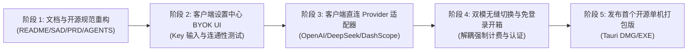

# 计划 025：开源单机 BYOK 本地优先架构演进 (025-standalone-byok-architecture)

> **给执行者：** 本计划遵循严格 TDD（测试驱动开发）与 Local-First/Zero-Content 隐私保护铁律，按任务顺序执行。

**Plan ID：** `025-standalone-byok-architecture`  
**创建时间：** 2026-11-06  
**最后更新：** 2026-11-06 17:00  
**当前状态：** 已完成（Phase 1~4 全部落地并通过全套自动化工程门禁）  
**负责人：** Antigravity  
**目标：** 将听序（Tingxu）彻底改造为 100% 纯前端单机桌面工具（Local-First Desktop App），零中心化服务依赖，彻底移除云托管支援、登录拦截与商业化支付，实现自备 Key（BYOK）个人开箱即用。  
**架构摘要：** 确立 100% Local-First 单机纯净架构；客户端直接对接 OpenAI 兼容大模型（DeepSeek/通义千问/Ollama/自定义端点）与 DashScope 实时 ASR；侧边栏与计费中心升级为本地会议时长与 Token 成本透视；彻底移除登录拦截与支付逻辑；全套 70 个测试套件（382 个单元测试）与 5 大工程质量门禁全绿。  
**技术栈：** Tauri 2.0, Rust, React 18, TypeScript, WebSocket, SQLite (Rusqlite + FTS5), Vitest

---

## 1. 背景与核心动机

听序（Tingxu）在早期设计中采用了三层架构（客户端 + 控制面 Server + AI Gateway），目的是支撑企业级商业化闭环（手机号验证码注册、微信商户支付、时长套餐预占扣减与审批后台）。

随着项目决定全面开源并服务更广泛的个人办公人群，原有的重型商业后端成为用户上手使用与社区贡献的重大包袱：
1. **过高的部署心智负担**：普通个人用户若想体验，必须配置 Docker、PostgreSQL、Redis、NestJS 并接入短信与支付网关，门槛极高；
2. **纯粹的单机使用诉求**：广大用户拥有自己的阿里云百炼（DashScope）或 DeepSeek API Key，希望开箱即用，直接填 Key 即可启动会议记录；
3. **彻底的本地主权**：数据 100% 留存在本地 SQLite，甚至未来支持对接本地 Ollama / Whisper，实现完全断网环境下的单机运作。

因此，听序架构正式升级为 **“单机 BYOK 为主（默认一等公民），云端增援托管为辅（可选扩展）”** 的双模架构（Dual-Mode Architecture）。

---

## 2. 架构演进与接缝（Seams）重构

### 2.1 接缝一：LLM 调度契约（Direct BYOK Client）
- **现状**：前端通过 `HttpTingxuClient` 调用 `AI Gateway`，Gateway 在服务端注入系统 Prompt，再调用 DeepSeek / Qwen。
- **演进**：
  - 在客户端抽离统一的 `LlmEngine` 契约；
  - 提供 `ByokLlmClient` 适配器：支持直接调用各大厂商的 OpenAI 兼容端点（DeepSeek, 阿里云百炼兼容模式, 月之暗面, 硅基流动, 以及本地 Ollama `http://localhost:11434/v1`）；
  - 保留 `GatewayClient` 适配器：当用户配置云端托管服务时，无缝切换为网关代理。

### 2.2 接缝二：流式 ASR 直连契约（Streaming ASR Seam）
- **现状**：前端连接 Gateway WebSocket，Gateway 转发至阿里云百炼 DashScope WebSocket。
- **演进**：
  - **单机 BYOK 模式**：前端 `RealStreamingAsrClient` 支持直接配置阿里云百炼的 WebSocket 鉴权协议，客户端直连阿里云百炼实时转写接口；
  - **离线端侧模式（未来）**：提供本地端侧 ASR（如基于 sherpa-onnx / SenseVoice / Whisper.cpp 的本地引擎适配器），实现零网络依赖；
  - **云端模式**：继续保留指向远程 Gateway 的中继连接。

### 2.3 接缝三：凭据安全与设置中心（Secure BYOK Settings）
- 在本地持久化配置（SQLite `app_settings` 表与安全受保护存储）：
  - `llmProvider`: `'deepseek' | 'qwen' | 'custom' | 'ollama'`
  - `llmApiKey`: 用户输入的 API 密钥
  - `llmBaseUrl`: 对应的 API 请求基地址
  - `llmModel`: 模型标识（如 `deepseek-chat`, `qwen-plus`）
  - `asrProvider`: `'dashscope' | 'custom' | 'local'`
  - `asrApiKey`: 阿里云百炼 API Key / AppKey
  - `asrEndpoint`: WebSocket 端点
  - `mode`: `'standalone'`（默认）或 `'cloud'`
- 设置界面（SettingsView）提供一键「测试连接」交互，即时检验 Key 有效性与延迟。

### 2.4 接缝四：商业化与计费解耦
- **单机模式**：取消强制登录弹窗拦截；会议时长无限制；
- 计费看板（BillingView）演进为 **「Token 用量与成本透视表（Usage & Cost Estimator）」**，直观展现调用 Token 数与节省费用，提升用户掌控感。

---

## 3. 落地分步实施计划

### 任务细分：
1. **Phase 1（规范与文档）**：
   - [x] 确立双模架构演进规范；
   - [x] 创建根目录开源 `README.md`；
   - [x] 更新 `AGENTS.md`、`docs/README.md`、`PRD.md`、`SAD.md`；
   - [x] 验证 5 大工程门禁无破坏。
2. **Phase 2（SettingsView 扩展）**：
   - [x] 在 `SettingsView.tsx` 中增加「AI 模型与语音识别配置 (BYOK)」板块；
   - [x] 支持填入 DashScope API Key、DeepSeek API Key、自定义 Base URL；
   - [x] 增加「测试连接」按钮并给出 HTTP/WebSocket 联通状态；
   - [x] 本地持久化保存与读取配置。
3. **Phase 3（客户端直连 Client 实现）**：
   - [x] 实现 `ByokLlmClient`：在前端/桌面端直接封装 OpenAI 兼容协议流式调用；
   - [x] 保证与现有的 `InMeetingWorkbench`、`MeetingSummaryView`、`Copilot` 接口完全无缝对接；
   - [x] 编写 `src/api/__tests__/byokLlmClient.test.ts` 完整通过。
4. **Phase 4（纯单机免登录改造与体验优化）**：
   - [x] 解耦网关强阻断守卫（单机模式无需 Gateway 即可畅通开会）；
   - [x] 彻底移除登录弹窗拦截与云托管模式切换，实现 100% 本机免登录直接启动；
   - [x] 侧边栏与时长看板升级为本地会议时长与 Token 消耗透明度透视，移除微信支付与充值；
   - [x] 全套 70 个测试套件（382 个单元测试）全部绿灯通过；
   - [x] 全套 5 大自动化质量门禁（Gate 1~5）100% 通过。

---

## 4. 交付物与验证清单

1. **纯单机免登录启动**：`npm run tauri dev` 启动直接进入会议工作台，无任何登录弹窗，侧边栏底部展示「单机免登录 · 100% 数据本地留存」；
2. **BYOK 密钥配置与探活**：系统设置页具备完整的 DeepSeek / 阿里百炼 / 本地 Ollama / 自定义端点一键切换与连通性探活测试；
3. **时长与用量中心**：主打本地已记录会议时长、累计 Token 与单场 API 算力成本透明度看板，无任何商业支付购买干扰；
4. **质量门禁保证**：执行 `bash scripts/verify-gates.sh`，Gate 1~5 全绿通过。
