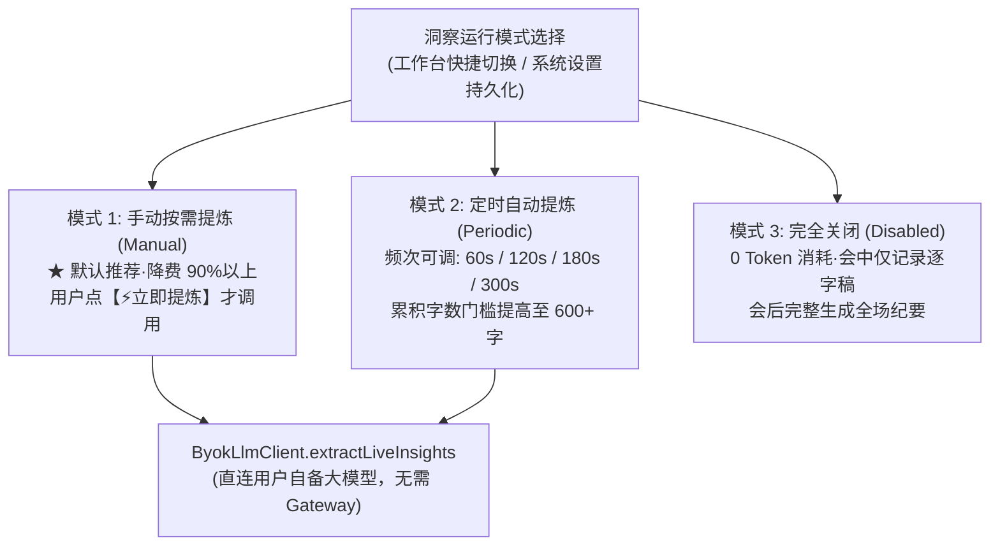

# 计划 026：实时洞察降费控频与总结报告 Header 布局重构 (026-insight-cost-control-and-summary-header-optimization)

> **给执行者：** 本计划严格遵循 TDD（测试驱动开发）、Zero-Content 隐私红线与 Impeccable 工业级设计规范。

**Plan ID：** `026-insight-cost-control-and-summary-header-optimization`  
**创建时间：** 2026-11-06  
**最后更新：** 2026-11-06 17:10  
**当前状态：** 已完成（所有任务落地并通过全套自动化工程门禁）  
**负责人：** Antigravity  
**目标：**  
1. **实时洞察降费与模式控制**：解决会中实时洞察频繁调用大模型（原 25s 定时 + 文本累积盲目请求）导致的高额 API 费用问题，提供「手动按需提炼（Manual，推荐省钱）」、「定时低频自动（Periodic，60s~300s 可调）」以及「完全关闭（Disabled，0 费用）」三种模式，并在会中看板提供「⚡ 立即提炼洞察」手动按钮；
2. **总结报告 Header 布局深度优化**：彻底解决目前总结报告 Header 区域内容密集、折行错位、标题就地编辑/重新提炼与右侧操作按钮相互挤压碰撞的问题，采用优雅清爽的「两段式（双层）架构」重构。

---

## 1. 痛点深度剖析

### 1.1 实时洞察费用痛点
1. **无感盲目高频触发**：原逻辑在发言每累积 300 字或每 25 秒静音即自动请求一次大模型，一场 1 小时会议往往调用 60~100 次大模型；在自备 Key（BYOK）模式下，单场会议 Token 消耗可达数十万，产生不必要的 API 账单；
2. **缺乏关闭与控制权**：用户有时只需单纯录音与双轨逐字稿，不希望会中频繁调用 AI；或希望在讨论到关键议题时才按需触发一次总结。

### 1.2 总结报告 Header 布局混乱痛点
1. **单行横向过度拥挤（Horizontal Cramping）**：Header 试图在单行内塞入「返回工作台」、「标题」、「✏️ 就地重命名」、「🤖 重新提炼主题」、「成功/失败反馈横幅」、「📅 日期」、「⏱ 时长」、「已收录段落」、「👥 参会人列表（可多达 8 人）」、「💰 AI 成本徽章」以及右侧 3 个操作按钮；
2. **多元素互相推挤与折行抖动（Layout Shift）**：标题稍长或参会人较多时，自动折行撑大 Header 高度；点击「重新提炼」出现提示标签后，横向推开右侧所有元素，造成严重的视觉混乱。

---

## 2. 架构与 UI/UX 重构方案

### 2.1 实时洞察控制体系（Insight Control System）



#### 数据模型与 Store 定义：
```ts
export type LiveInsightMode = 'manual' | 'periodic' | 'disabled';

export interface LiveInsightSettings {
  mode: LiveInsightMode; // 默认 'manual'
  intervalSeconds: number; // 默认 120 秒 (可调 60/120/180/300)
  minCharsThreshold: number; // 默认 500 字
}
```

#### 工作台与设置页交互：
1. **会中工作台左侧看板顶部**：
   - 增加模式切换胶囊：`[⚡ 手动提炼] | [⏱ 自动 (120s)] | [⏸ 关闭]`；
   - 增加显眼的主操作按钮：`[⚡ 立即提炼洞察]`，悬停提示当前未处理发言字数（如“当前待提炼: 420 字”），点击触发单次增量抽取；
   - 当模式为 `disabled` 时，渲染节能提示：“💡 实时洞察已暂停，节省 API 算力。会后仍可一键生成全场完整纪要。”
2. **系统设置页**：
   - 增加「💡 实时洞察与算力节能控制」卡片，持久化配置默认运行模式与周期。

---

### 2.2 总结报告 Header 两段式架构重构

参考 `UIUX-DESIGN-SPEC.md` 的 Impeccable 极简克制标准，将 Header 分解为**上层全局导航操作栏**与**下层主题元数据看板**：

```text
+----------------------------------------------------------------------------------------------------+
| [← 返回工作台]  |  会议工作台 / 会议总结报告                     [💰 成本 ¥1.20]  [🤖 Copilot]  [📋 复制]  [⬇ 导出 MD] |  <- 上层: 固定 48px, 坚决不折行
+----------------------------------------------------------------------------------------------------+
| 会议主题名称 (点击就地内联编辑)  [✏️]  [🤖 重新提炼主题]  (Toast浮层提示状态，不推挤)                      |  <- 下层第1行: 主题区
| 📅 2026-11-06 14:00  ·  ⏱ 时长 45分30秒  ·  💬 82段发言  ·  👥 参会人: [张总] [李工] [王经理]          |  <- 下层第2行: 元数据区
+----------------------------------------------------------------------------------------------------+
```

#### 关键体验提升：
1. **彻底杜绝横向打架**：返回键与主操作组固定在顶部工具条，不管标题多长、参会人多少，右侧操作按钮永远稳定对齐、触手可及；
2. **主题行自适应展开**：标题具备专属水平展示空间，支持就地内联修改（点击即输入，回车保存，Esc 取消）；
3. **Toast 浮层反馈**：重新提炼的“正在提炼...”、“主题更新成功”采用绝对定位渐隐 Toast，绝不横向推挤其他元素；
4. **参会人优雅胶囊组**：参会人独立展示为细边框微型胶囊，点击快速重命名，超出自动折叠显示 `+N`。

---

## 3. 落地实施路线与任务拆解

### 任务 1：数据模型与 Store 状态扩展 (TDD)
- [x] 在 `src/types/meeting.ts` 中定义 `LiveInsightMode`、`LiveInsightSettings`；
- [x] 在 `useMeetingStore.ts` 中实现 `liveInsightSettings`、`updateLiveInsightSettings` 与 `triggerManualInsight`；
- [x] 编写 Store 单元测试，验证模式切换、手动触发调用与配置持久化。

### 任务 2：ByokLlmClient 增量提炼方法实现
- [x] 在 `ByokLlmClient.ts` 中增加 `extractLiveInsights(combinedText, currentTopicSummary, contextAnchors)`；
- [x] 适配 `meetingPipelineService.ts`：读取 `liveInsightSettings`，在 `disabled` 模式下跳过计时器与追加触发，在 `periodic` 模式下按配置间隔触发，在 `manual` 模式下仅响应手动触发；
- [x] 编写单元测试验证低频调度与手动触发逻辑。

### 任务 3：会中工作台与系统设置 UI 落地
- [x] 在 `InMeetingWorkbench.tsx` 看板顶部实现模式切换胶囊与「⚡ 立即提炼洞察」按钮；
- [x] 支持待提炼字数展示与关闭状态提示；
- [x] 在 `SettingsView.tsx` 中增加「💡 实时洞察与算力节能控制」卡片。

### 任务 4：总结报告 Header 两段式架构重构
- [x] 重构 `MeetingSummaryView.tsx` 的 Header 为固定高度顶栏 + 主题元数据 Banner；
- [x] 优化标题就地编辑输入框与反馈 Toast 浮层；
- [x] 优化参会人胶囊列表展示与 AI 成本徽章放置。

### 任务 5：自动化门禁与全量测试验证
- [x] 运行 `npm test` 确保全部 71 个测试套件（387 个单元测试）通过；
- [x] 运行 `bash scripts/verify-gates.sh` 确保 Gate 1~5 全部绿灯。
