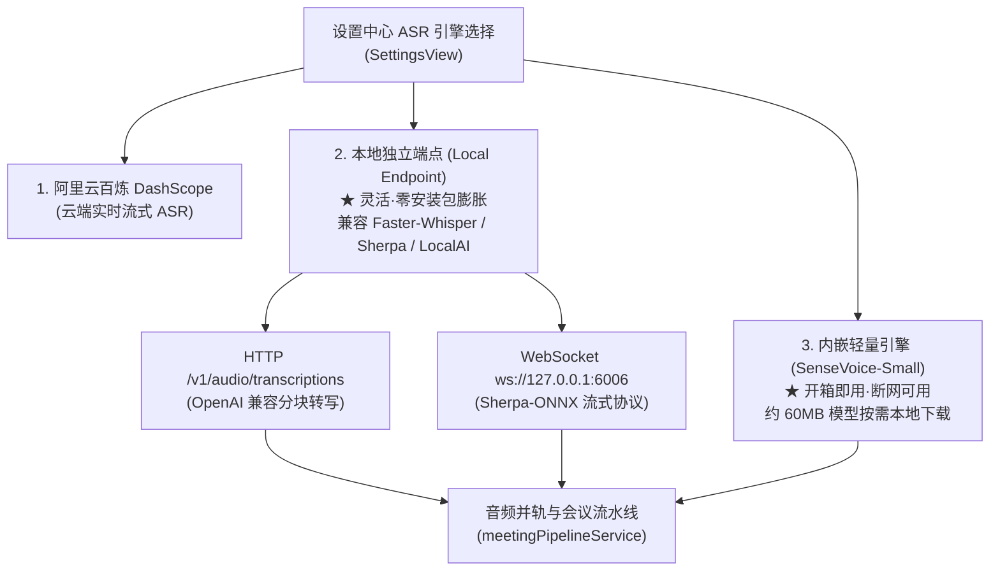

# 计划 027：本地离线 ASR 语音识别双轨演进引擎 (027-local-offline-asr-engine)

> **给执行者：** 本计划严格遵循 TDD（测试驱动开发）、Zero-Content 隐私红线与 Local-First 架构准则，按任务顺序执行。

**Plan ID：** `027-local-offline-asr-engine`  
**创建时间：** 2026-11-06  
**最后更新：** 2026-11-06 22:30  
**当前状态：** 待开始  
**负责人：** Antigravity  
**目标：** 实现听序（Tingxu）全流程「本地离线 ASR 语音识别」双轨演进体系。摆脱对商业云端 ASR（DashScope）的唯一依赖，既支持直连本机运行的 Faster-Whisper / Sherpa-ONNX / OpenAI 格式本地语音服务，也支持桌面端内置 SenseVoice-Small（约 60MB）轻量模型按需下载与原生推理，实现 100% 断网可用、零 API 成本与极致隐私安全。

---

## 0. 状态管理与任务总览

### 0.1 整体进度
- **阶段划分：**
  - [ ] Phase 1: ASR 协议契约扩展与 LocalAsrClient 客户端适配器 (TDD)
  - [ ] Phase 2: 设置中心（SettingsView）本地 ASR 配置与即时连通性探测
  - [ ] Phase 3: 会中音频流水线（meetingPipelineService）多源 ASR 无缝切换
  - [ ] Phase 4: Rust 底层 SenseVoice-Small 模型下载与离线管理
  - [ ] Phase 5: 异常边界容错、E2E 测试与 5 大工程质量门禁全绿

**完成度：** 0/7（0%）

### 0.2 任务状态总览

| 任务ID | 任务名称 | 执行模式 | 并行组 | 依赖任务 | 状态 | 负责人 | 开始时间 | 完成时间 | 阻塞原因 | 验证证据 |
|---|---|---|---|---|---|---|---|---|---|---|
| T01 | 扩展 AsrProviderType 契约与本地存储（新增 local_endpoint 与 local_embedded） | 串行 | - | 无 | 待开始 | 核心架构 | - | - | 无 | src/types/meeting.ts, byokSettings.test.ts |
| T02 | 实现 LocalAsrClient 客户端：支持 OpenAI HTTP 与 Sherpa/FunASR WebSocket 双模适配 (TDD) | 串行 | - | T01 | 待开始 | 音频引擎 | - | - | 无 | src/audio/localAsrClient.ts, localAsrClient.test.ts |
| T03 | 重构 meetingPipelineService 支持动态调度 LocalAsrClient 与逐字稿事件流平滑并轨 (TDD) | 串行 | - | T02 | 待开始 | 音频引擎 | - | - | 无 | src/audio/meetingPipelineService.ts, test |
| T04 | 设置中心（SettingsView）新增「本地离线 ASR」配置区、预设推荐端点与一键连通性测试 | 串行 | - | T03 | 待开始 | 前端UI | - | - | 无 | SettingsView.tsx, SettingsViewAsr.test.tsx |
| T05 | Rust 底层提供 SenseVoice-Small 模型本地状态检测、下载器与校验命令 (Tauri Command) | 串行 | - | T01 | 待开始 | Rust底层 | - | - | 无 | src-tauri/src/asr/local_model.rs, cargo test |
| T06 | 会中工作台 ASR 离线感知与未就绪引导（零阻断降级与友善提示卡片） | 串行 | - | T04, T05 | 待开始 | 前端UI | - | - | 无 | InMeetingWorkbench.tsx, data-testid |
| T07 | 全量自动化测试回归、门禁验证与文档更新（Gate 1~5 全绿） | 串行 | - | T06 | 待开始 | QA合规 | - | - | 无 | scripts/verify-gates.sh 全绿 |

---

## 1. 需求分析与痛点背景

### 1.1 核心动机
1. **云端 ASR 成本与密钥门槛**：此前听序仅直连阿里云百炼 DashScope 实时 ASR，虽然中文准确率高，但用户必须注册阿里云账号、开通百炼、创建 API Key，且会产生商业语音转写计费；
2. **断网与内网保密会议需求**：在政府、军工、金融内网或差旅无网络环境下，用户无法开启语音转文字功能；
3. **开源生态与自建服务整合**：本地 AI 生态中，Faster-Whisper Server、Sherpa-ONNX、Ollama 以及 LocalAI 等开源 ASR 服务已被大量技术用户部署在本机（如 `localhost:8000` 或 `localhost:6006`），听序应当无缝接驳这些标准端点。

### 1.2 双轨演进架构


### 1.3 验收标准（Acceptance Criteria）
- **AC-01**：设置中心提供「本地独立端点（Local Endpoint）」与「内嵌离线模型（Embedded SenseVoice）」选项；
- **AC-02**：选择本地独立端点时，支持配置 `http://127.0.0.1:8000`（OpenAI HTTP 协议）或 `ws://127.0.0.1:6006`（Sherpa WebSocket 协议），点击「测试连接」可即时反馈连通性；
- **AC-03**：选择本地 ASR 开启会议后，麦克风音频以 16kHz PCM 正确分块或流式发送至本地端点，逐字稿面板实时渲染返回的文本；
- **AC-04**：当本地 ASR 未启动或连接断开时，系统呈现温和重试与提示，不发生崩溃或阻塞其他界面；
- **AC-05**：若用户未下载内嵌模型，设置页清晰标注「未下载（约 60MB）」，点击支持进度条下载与 SHA256 完整性检验；
- **AC-06**：全套 5 大自动化工程质量门禁（Gate 1~5）100% 绿色通过，且无任何明文 Key 泄漏。

---

## 2. 代码影响分析（Codebase Impact Analysis）

- **分析模式**：直接源码分析与调用链静态分析（基于项目当前纯单机目录体系）。
- **受影响模块与文件**：
  1. `src/types/meeting.ts`：扩展 `AsrProviderType`，增加 `local_endpoint` 和 `local_embedded` 枚举，增加本地端点协议类型 `LocalAsrProtocol = 'openai_http' | 'sherpa_ws' | 'funasr_ws'`；
  2. `src/store/useMeetingStore.ts`：增加本地 ASR 配置项状态与持久化适配；
  3. `src/audio/localAsrClient.ts`（新增）：核心双模客户端，统一封装 HTTP 分块 POST 与 WebSocket 流式通信，转换为听序标准 `AsrTranscriptEvent`；
  4. `src/audio/meetingPipelineService.ts`：重构 ASR 实例化逻辑，根据 `asrProvider` 路由到 `RealStreamingAsrClient` 或 `LocalAsrClient`；
  5. `src/components/views/SettingsView.tsx`：新增本地 ASR 配置卡片、预设端点下拉框（Faster-Whisper, Sherpa, FunASR）及连通性测试按钮；
  6. `src-tauri/src/main.rs` & `src-tauri/src/asr/mod.rs`：扩展 Rust 原生模型管理与文件下载命令。
- **公共契约变动**：向后兼容现有 `ByokSettings`，仅新增可选字段，默认回退机制保障老数据平滑迁移。

---

## 3. 详细实施任务拆解（TDD 驱动）

### 阶段一：协议契约与客户端适配器（T01~T02）
- [ ] **T01: 契约扩展**
  - 修改 `src/types/meeting.ts`：
    ```ts
    export type AsrProviderType = 'dashscope' | 'custom' | 'local_endpoint' | 'local_embedded';
    export type LocalAsrProtocol = 'openai_http' | 'sherpa_ws';
    ```
  - 编写/扩充 `byokSettings.test.ts`，验证本地 ASR 属性的初始化与持久化。
- [ ] **T02: LocalAsrClient 实现 (TDD)**
  - 编写测试 `src/audio/__tests__/localAsrClient.test.ts`：
    - 测试用例 1：OpenAI 兼容 HTTP 端点分块提交音频并返回逐字稿文本；
    - 测试用例 2：Sherpa-ONNX 兼容 WebSocket 实时双向流；
    - 测试用例 3：网络断开/离线重连与有界超时处理；
  - 编写实现 `src/audio/localAsrClient.ts`。

### 阶段二：会议音频流水线接入（T03）
- [ ] **T03: meetingPipelineService 调度接入**
  - 在 `src/audio/meetingPipelineService.ts` 中根据 `store.byokSettings.asrProvider` 自动装配对应 Client；
  - 确保输出标准的 `INTERIM` 与 `FINAL` 逐字稿事件；
  - 编写测试验证流水线启动与停止生命周期。

### 阶段三：设置中心交互与连通性测试（T04）
- [ ] **T04: SettingsView 本地 ASR 配置卡片**
  - 渲染本地 ASR 模式选择与常用预设（如 Faster-Whisper: `http://127.0.0.1:8000/v1/audio/transcriptions`；Sherpa-ONNX: `ws://127.0.0.1:6006`）；
  - 实现「⚡ 测试端点连通性」操作；
  - 覆盖规范 `data-testid` 属性并编写 UI 测试用例。

### 阶段四：Rust 底层轻量模型管理（T05）
- [ ] **T05: SenseVoice-Small 模型管理器**
  - 在 `src-tauri` 中新增本地缓存目录解析逻辑（`~/.tingxu/models/`）；
  - 提供 `check_local_asr_model()` 与 `download_local_asr_model()` 原生命令；
  - 编写 Rust 单元测试保障文件流下载不卡顿。

### 阶段五：会中体验与门禁回归（T06~T07）
- [ ] **T06: 会中工作台状态感知**
  - 当配置为本地 ASR 但端点不可达时，工作台状态条显示「本地 ASR 未连接，点击查看解决办法」；
  - 提供一键打开设置或切换为测试模式的操作。
- [ ] **T07: 全量回归与 Harness 质量门禁**
  - 运行 `scripts/verify-gates.sh`，保证 Gate 1~5 全绿通过；
  - 确保 TypeScript 零类型错误，300+ 单元测试全部通过。
