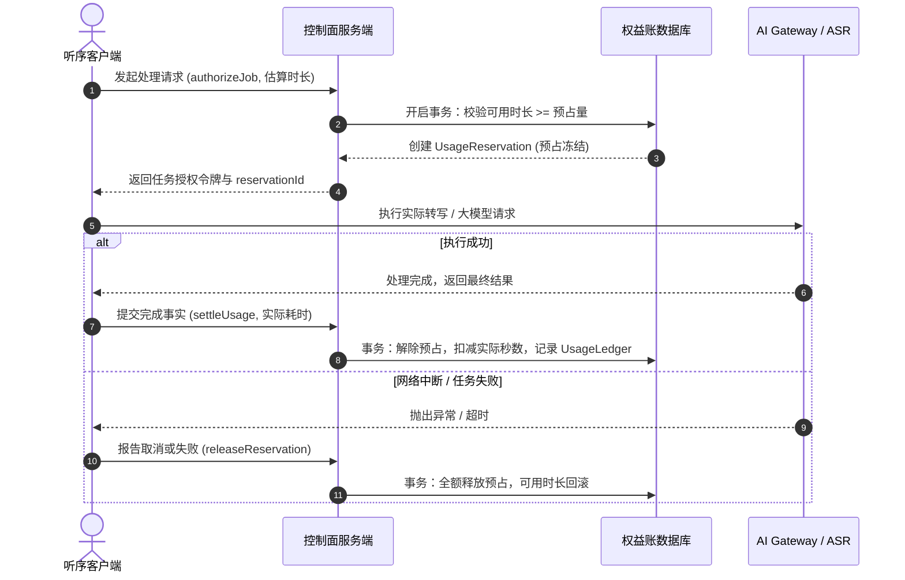
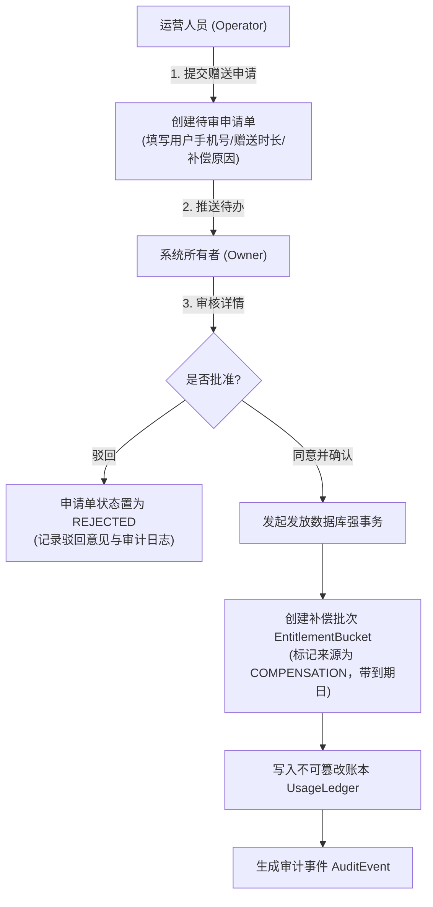

# 计费规则、运营后台与权益管理规范

**项目名称：** 听序（Tingxu）  
**文档版本：** v0.2（评审基准稿）  
**最后更新：** 2026-10-30  
**适用范围：** 听序桌面端商业化、服务端账务模块与独立 Web 运营管理后台  

---

## 1. 商业决策与核心模型

### 1.1 最新商业决策：按会议时长计费，AI 全纳入套餐
根据 2026-10-30 团队最新商业评审决策：
1. **统一计费维度**：现阶段严格采用**会议时长（以小时/月为包期单位）**作为用户侧唯一的套餐度量衡。
2. **AI 能力全包**：标准会中实时洞察、会后高精纪要、智能待办提取与本场问答**全量纳入套餐权益**。
3. **取消用户侧 AI 点数心智**：客户端与套餐购买页不再向用户展示“AI 点数余额”、“单次整理扣 2 点”、“每次提问扣 3 点”或“本场点数预算”。用户购买套餐后即可畅享标准 AI 辅助，彻底消除用户提问一次心理纠结一次的负向体验。
4. **内部成本账仍严密核算**：后台继续按供应商实际维度（ASR 秒数、LLM 输入/输出 token、单次请求费用）严密记录内部账目，用于毛利测算与防盗刷风控，但不把内部技术成本直接当成用户资产余额。

---

## 2. “三本独立账”设计

为防止将用户可用额度与第三方技术账单混淆，系统底层建立三本相互隔离且能够按任务交叉核对的账目体系：

```
┌────────────────────────────────────────────────────────────────────────┐
│                        听序业务底层“三本独立账”体系                    │
├───────────────────┬───────────────────────────────┬────────────────────┤
│ 账目名称          │ 计量单位                      │ 业务作用与权威边界 │
├───────────────────┼───────────────────────────────┼────────────────────┤
│ 1. 用户权益账     │ 会议时长（前台分钟/后台秒）   │ 决定客户端能否发起 │
│                   │ 套餐有效期 (天)               │ 录音转写与 AI 整理 │
├───────────────────┼───────────────────────────────┼────────────────────┤
│ 2. 供应商成本账   │ ASR 音频秒数 / 通道数         │ 用于系统毛利分析、 │
│                   │ LLM Prompt / Completion Token │ 异常高频调用拦截与 │
│                   │ 人民币（分）                  │ 第三方账单对账     │
├───────────────────┼───────────────────────────────┼────────────────────┤
│ 3. 商业交易账     │ 人民币（分）                  │ 微信支付实付、优惠 │
│                   │ 微信订单号 / 退款号           │ 折扣抵扣、退款流水 │
└───────────────────┴───────────────────────────────┴────────────────────┘
```

---

## 3. 权益预占、结算与失败补偿机制



### 3.1 预占规则与阶段结算
- **分阶段结算原则**：对于由多个阶段组成的长任务（例如“音频转写阶段 $\rightarrow$ 纪要生成阶段”），如果音频转写成功但大模型纪要阶段超时失败，系统**仅按实际成功完成的转写时长结算**，大模型失败部分全额释放预占，严禁出现“因后半段失败而将前半段已消耗的供应商成本算为用户恶意欠费”或“双重扣减”。
- **租约心跳与自动超时清理**：针对长时间开会的场景，客户端每 15 分钟与服务端进行一次预占续租（Heartbeat Lease）。若客户端异常强退且超过 30 分钟无心跳，服务端守护进程自动释放未完成的挂起预占，避免用户额度被死锁。

---

## 4. 微信支付对接与退款规范

### 4.1 下单与回调安全
1. **服务端绝对计算价格**：客户端发起购买时仅上报套餐 ID（`planId`）。套餐价格、优惠券抵扣、应付金额一律由服务端在数据库强事务中根据当前上架生效的版本快照进行二次核算，**严禁信任客户端传递的任何金额字段**。
2. **回调验签与幂等消费**：微信支付回调通知采用微信官方 API v3 平台公钥验签与解密。验签成功后，首先检查 `orders` 表该订单状态；若已经是 `PAID`，直接返回 HTTP 200 成功响应，防止微信重复网络重试导致套餐额度被多次发放（Outbox 消息按 `order_id + grant_type` 唯一键去重）。
3. **扫码支付展示**：采用微信支付 Native 支付模式，服务端生成微信支付链接 `code_url`，客户端将其渲染为扫码二维码，用户在桌面端使用手机微信扫码完成支付。

### 4.2 退款管理与审核流程
- **人工审核原则**：所有退款申请必须进入 Web 运营后台人工审核，禁止采用未经风控验证的公式自动秒级退款。
- **退款与权益冲正关联**：审核通过发起微信退款后，待微信退款成功回调到达时，系统依据该订单发放的权益批次执行关联冲正（Reverse Bucket）。若用户已将该批次时长全部消耗，需人工介入补交或按比例折算实退金额；退款绝不得将用户本地已有会议文件封锁或抹除。

---

## 5. 运营补偿、赠送与审批工作流



### 5.1 权限分离原则（Separation of Duties）
- **普通运营人员**：仅拥有“提交补偿申请”的权限，无权直接向任何用户账户无审批充值。
- **系统所有者（Owner）**：拥有最终审核批准权。所有者本人也可在授权规则内直接发起赠送，但所有操作必须在审计流水中记录清晰的操作人、目标用户、赠送数量及业务理由。
- **防重复发放约束**：每个赠送申请单在审批通过后，生成全局唯一的业务幂等流水号。数据库更新采用乐观锁（`version` 字段），防止双击或并发重试导致重复发放。

---

## 6. 独立 Web 运营管理后台规范

### 6.1 访问边界与用户隐私红线
- **绝对隐私红线（Zero-Content Policy）**：运营后台**完全不提供**任何查看用户会议名称、音频片段、逐字稿正文、洞察卡片内容或会议截图的接口与入口！后台只允许查看系统层面的脱敏手机号（如 `138****1234`）、套餐到期时间、时长预占/消耗秒数、任务状态与系统错误码。

### 6.2 运营后台功能模块清单

| 页面 ID | 模块名称 | 核心操作与功能 | 数据边界与保护 |
| :--- | :--- | :--- | :--- |
| **A-01** | 运营概览 (Dashboard) | 查看每日活跃独立用户数、转写时长总消耗、实付营收流水、任务成功率走势 | 统计数据基于脱敏聚合指标，不展示任何会议详情。 |
| **A-02** | 用户与权益 (Users & Quotas) | 按脱敏手机号搜索用户；查看其套餐版本、剩余时长批次明细；提交赠送时长申请 | 仅展示可用时长秒数与到期时间，不展示本地文件路径。 |
| **A-03** | 赠送与审批 (Adjustments) | 审批待处理的补偿赠送申请单；查看历史审批记录、驳回意见与发放流水 | 严格遵循权限分离，审批与发放操作永久记录审计。 |
| **A-04** | 订单与退款 (Orders & Refunds) | 检索微信交易订单、对账单明细、实付金额与优惠抵扣；提交与审查退款申请 | 商户密钥与完整付款凭据保存在服务端，不向前端暴露。 |
| **A-05** | 用量与成本 (Cost Analytics) | 按日期、ASR 通道与 LLM 模型（DeepSeek/Qwen）统计实际花费的人民币金额 | 仅统计 token 与调用秒数，不展示用户输入的上下文正文。 |
| **A-06** | 服务运行监控 (Service Health) | 实时监控 ASR 与 AI Gateway 响应时延、错误码分布（如网络超时、限流、熔断） | 展示不透明 `taskId` 与错误分类，不记录敏感请求体。 |
| **A-07** | 操作审计日志 (Audit Trails) | 查看后台管理员的登录、审批、配置变更流水，支持按操作人和时间过滤 | 审计日志物理防篡改，严禁提供任何删除或修改历史接口。 |

### 6.3 权限矩阵（RBAC）

| 操作项 | 系统所有者 (Owner) | 运营人员 (Operator) | 财务对账人员 (Finance) |
| :--- | :---: | :---: | :---: |
| 查看脱敏用户列表与权益总览 | ✅ 允许 | ✅ 允许（指定范围） | ❌ 无权 |
| 提交时长赠送补偿申请 | ✅ 允许 | ✅ 允许 | ❌ 无权 |
| 最终审批并执行时长发放 | ✅ 允许 | ❌ 无权（需所有者审） | ❌ 无权 |
| 套餐产品上架、下架与改价 | ✅ 允许（版本化） | ❌ 无权（只读） | ❌ 无权 |
| 提交退款申请并退回微信商户 | ✅ 允许（复核） | ❌ 无权 | ✅ 允许（协同） |
| 查看微信流水与财务对账单 | ✅ 允许 | ❌ 无权 | ✅ 允许 |
| 查看与导出审计日志 | ✅ 允许 | ❌ 无权 | ❌ 无权 |
| **查看任何用户的会议具体内容** | 🚫 **全员禁止** | 🚫 **全员禁止** | 🚫 **全员禁止** |
