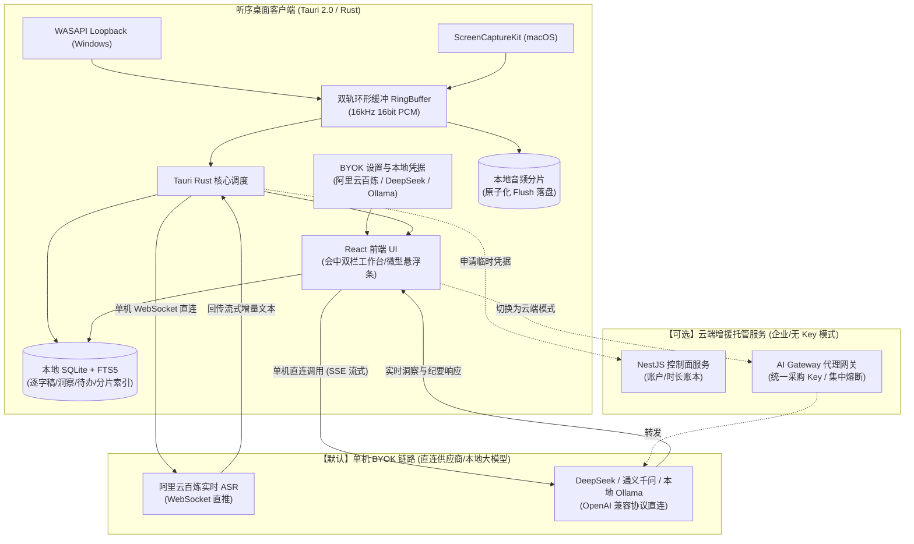
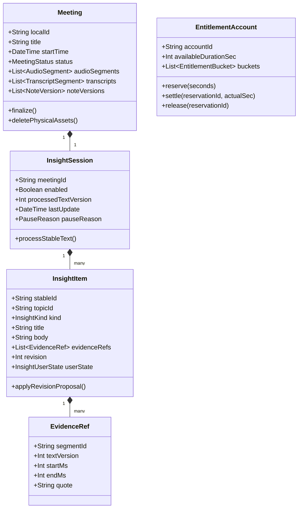

# 软件架构设计文档（SAD）

**项目名称：** 听序（Tingxu）— AI 实时会议记录与智能纪要桌面助手  
**代码仓库名：** `tingxu`  
**项目代号：** `tingxu-desktop`  
**文档版本：** v0.3（开源单机 BYOK 与双模架构升级）  
**最后更新：** 2026-11-06  
**架构负责人：** 听序核心研发架构团队  

---

## 1. 架构概述与设计原则

### 1.1 系统概述
听序（Tingxu）是一款基于 **Local-First（本地优先）** 原则构建的开源桌面端跨平台 AI 会议生产力软件。系统确立了“单机 BYOK（Bring Your Own Key）为主，云端增援托管为辅”的双模架构体系：
1. **单机本地模式（Standalone BYOK Mode，默认一等公民）**：用户直接运行桌面客户端（Tauri 2.0 / Rust + React），在本地配置自备的 API Key（阿里云百炼 ASR、DeepSeek、通义千问或本地离线 Ollama）。音频采集、流式转写、会中洞察与会后纪要全链路在本地闭环驱动，**完全不依赖任何外部后端服务与数据库**。
2. **云端增援托管模式（Hosted Cloud Mode，可选企业/集中模式）**：针对无自备 Key 的个人用户或团队集中采购场景，提供可选的 NestJS 商业控制面（账户、时长流水记账）与自建 AI Gateway 网关（Prompt 注入、多模型熔断路由与脱敏审计）。

### 1.2 核心架构原则
- **原则一：双轨无感采集与物理分流（Dual-Track Physical Isolation）**  
  将麦克风（本地发言人）与系统扬声器（远端所有发言人）在硬件级进行独立录制与通道打标，从根本上杜绝传统单声道混音导致的角色混淆。
- **原则二：大流量数据面直连，零音频中转损耗（Direct Data Plane）**  
  高吞吐的实时音频流直接通过客户端 WebSocket 推送至流式 ASR 供应商（或端侧本地 ASR 引擎），自建云端不中转大流量实时音频。
- **原则三：凭据安全与用户私钥本地沙箱隔离（BYOK Sandbox Security）**  
  用户在单机模式下配置的私有 API Key 遵循本地沙箱隔离原则，仅保存在用户本机的受保护存储中，仅用于直连用户指定的服务商端点，代码与构建产物中严禁硬编码开发者私钥，严禁非法回传。
- **原则四：Local-First 本地优先与数据主权（Privacy-Preserving Storage）**  
  会议标题、音视频文件、逐字稿正文、洞察卡片与手动手记**100% 只存放在本机 SQLite** 中。无论是单机模式还是云端增援模式，云端绝对不持久化用户会议正文内容。

---

## 2. 技术选型矩阵与核心理由

```
┌────────────────────────────────────────────────────────────────────────┐
│                        听序技术架构技术选型矩阵                         │
├───────────────────┬───────────────────────────────┬────────────────────┤
│ 层次/模块          │ 生产推荐选型                  │ 核心决策理由       │
├───────────────────┼───────────────────────────────┼────────────────────┤
│ 桌面端框架        │ Tauri 2.0 (Rust + React)      │ 内存仅 30-50MB     │
│ Windows 音频采集  │ WASAPI Loopback (原生)        │ 零驱动无感捕获     │
│ macOS 音频采集    │ ScreenCaptureKit (macOS 13+)  │ 苹果官方免驱通道   │
│ 流式 ASR 引擎     │ 阿里百炼 / 讯飞 ASR WebSocket │ 中文识别精度行业最高│
│ 大模型纪要引擎    │ DeepSeek-V3 + Qwen-2.5-72B    │ 极高性价比、双互备 │
│ 客户端本地数据库  │ SQLite 3 (Rusqlite + FTS5)    │ 本地全文检索、可靠 │
│ 云端控制面后端    │ Node.js (NestJS) + PostgreSQL │ 强事务 ACID 保障交易│
└───────────────────┴───────────────────────────────┴────────────────────┘
```

### 2.1 桌面端框架：Tauri 2.0 (Rust + React)
- **对比 Electron**：Electron 应用常驻内存高达 150-300MB，对于需要全程悬浮常驻的会议工具而言过于沉重。Tauri 2.0 基于系统原生 WebView，空载常驻仅 30-50MB。
- **底层优势**：Rust 提供无 GC 停顿的极高内存安全性能，处理持续音频采样、环形缓冲、重采样与 C-FFI / 操作系统底层 API 拥有工业级稳健性。

### 2.2 双端音频采集选型
- **Windows**：调用 Windows 核心音频 API `WASAPI Loopback`。从 Windows Vista 起原生支持捕获输出终端的音频渲染流，无需引导用户安装虚拟声卡驱动（如 Virtual Audio Cable）。
- **macOS**：调用 macOS 13+ 引入的原生 `ScreenCaptureKit` 音频流 API。绕过 BlackHole 等虚拟驱动安装，直接捕获系统扬声器混音，与 Granola、Limitless 采用相同官方推荐路径。

### 2.3 大模型与 AI Gateway
- **主力模型**：DeepSeek-V3（超高推理能力与极低 API 成本）。
- **热备模型**：Qwen-2.5-72B（中文理解与长文本结构化稳定性高）。
- **容灾机制**：AI Gateway 实时探测响应延时与错误率，DeepSeek 发生超时或限流时自动热切换至 Qwen-2.5，保障用户端无感知。

---

## 3. 系统架构与数据流图

### 3.1 端到端系统交互拓扑



    %% 交易与鉴权
    UI -- 登录/查权/下单 --> APIServer
    APIServer --> CloudDB
    APIServer --> WeChat
    APIServer --> AliSMS
```

### 3.2 运行时数据流向说明
1. **音频捕获与落盘（先落盘，后发送）**：音频采集线程将 PCM 帧灌入 `RingBuffer`，优先以 2 秒为周期切片写入本地磁盘分块文件，确保断网或崩溃时物理录音不丢失。
2. **ASR 转写流**：向控制面请求获取有时限的临时 ASR 访问凭据，直连 WebSocket 推送音频帧，接收带时间戳的临时字（Interim）与确定稳定字（Final）。
3. **会中实时洞察增量**：客户端调度器基于 VAD 静音与文本量（如新增有效文字 $\ge 300$ 字或 45 秒静默）将稳定片段经 AI Gateway 送入大模型，大模型返回 `add / update / retract` 结构化补丁并更新本地洞察库。
4. **会后高精纪要**：会议结束由客户端调用全局重整流水线，送出全场最终逐字稿，AI Gateway 调度大模型输出多维度结构化报告并存为 `NoteVersion`。

---

## 4. 领域驱动设计（DDD）核心模型

### 4.1 限界上下文划分

| 限界上下文 (Context) | 主数据位置 | 核心聚合根 (Aggregate Root) | 职责与协作关系 |
| :--- | :--- | :--- | :--- |
| **会议工作区 (Meeting Workspace)** | 本机 SQLite | `Meeting`, `ActionItem` | 维护单场会议全部生命周期、洞察卡片与待办事项。 |
| **媒体捕获 (Media Capture)** | 本机文件/内存 | `CaptureSession`, `MediaAsset` | 底层音频设备的监听、分片切分落盘与系统权限检测。 |
| **会中洞察 (Live Insights)** | 本地内存/SQLite | `InsightSession`, `InsightItem` | 增量滑动窗口调度、补丁合并与人工保护状态机。 |
| **用户身份 (Identity)** | 云端 PostgreSQL | `Account`, `Session` | 国内手机号登录认证、Token 签发与账号设备绑定。 |
| **权益与时长账 (Entitlements)** | 云端 PostgreSQL | `EntitlementAccount`, `UsageReservation` | 会议时长套餐管理、预占扣减、冲正与不可篡改审计。 |
| **商业交易 (Commerce)** | 云端 PostgreSQL | `Order`, `Payment`, `Refund` | 微信订单生成、回调验签、退款审查与交易状态机。 |
| **运营治理 (Governance)** | 云端 PostgreSQL | `AdjustmentRequest`, `AuditEvent` | 运营赠送时长申请、所有者审批流与操作审计日志。 |

### 4.2 核心实体与领域不变量



- **不变量一：人工保护不可篡改性**  
  当 `InsightItem.userState.confirmed == true` 或 `humanRevision > 0` 时，外部传入的新补丁若存在语义分歧，**禁止原地覆盖原属性**，必须追加进 `InsightRevision` 并发出 `RevisionReviewRequired` 事件等待用户人工仲裁。
- **不变量二：事实必须有证据锚定**  
  `InsightItem` 的类别若为“会议事实”、“明确决定”或“数值承诺”，其 `evidenceRefs` 数组不得为空，每个证据必须指向本地真实存在的 `TranscriptSegment`。
- **不变量三：录音与 AI 状态物理解耦**  
  `CaptureSession`（音频录制）的运行状态绝对独立于 `InsightSession`（AI 分析）。AI 报错、超时、断网或配额不足均不得调用音频停止命令。

---

## 5. 关键架构决策（ADR 清单）

### ADR-001：流式 ASR 直连与受控中继防刷架构
- **背景**：直接将客户端直连云厂商流式 ASR 可做到服务端 0 带宽与 0 音频损耗，但存在恶意用户提取临时 STS 凭证滥用刷爆企业 ASR 账单的风险。
- **决策**：
  1. 上线前核验云厂商 STS 策略：是否支持严格会话单次最长时长（如强制最多 2 小时）、单个账号并发限制与精确用量上限回调；
  2. 若云厂商支持严格防刷约束，执行**客户端直连架构**，配合服务端 15 分钟心跳续签与预占租约；
  3. 若云厂商不支持单会话硬顶控制，立即激活备选的**受控流式内存中继（In-Memory Relay）**：客户端通过 WebSocket 连接自建网关，网关在内存中以只读流转发给 ASR，严禁落盘，并进行精确流量与秒级限额切断。

### ADR-002：客户端在线驱动 AI 处理，云端不持久化会议正文
- **背景**：长会议纪要可能需要较长整理时间，如果在服务端离线跑任务，服务器就必须持有用户的会议逐字稿正文。
- **决策**：坚持 Local-First 原则，服务端不持有正文数据库。所有会中增量与会后纪要任务均由客户端在线按检查点（Checkpoints）分阶段驱动。如果客户端中途异常退出，下次重启后由客户端本地重新送入未完成阶段，确保云端“正文零留存”。

### ADR-003：商业服务端采用 NestJS 模块化单体与 PostgreSQL 强事务
- **背景**：初期用户量与并发处于验证与成长阶段，避免过早拆分微服务带来分布式事务（如微信支付回调与时长发放不一致）的复杂度。
- **决策**：采用模块化单体（Modular Monolith）架构，由 PostgreSQL 提供强 ACID 事务保障。通过 Outbox Pattern 驱动跨模块异步事件（如订单支付完成异步发放套餐批次）。

### ADR-004：系统密钥库与本地数据库加密
- **背景**：本地 SQLite 包含会议明文和纪要，需防范其他本地程序非法窥视。
- **决策**：在 Windows 上利用 DPAPI（Data Protection API），在 macOS 上利用 Keychain（系统钥匙串）安全保存本地加密密钥。SQLite 推荐结合 SQLCipher 拓展提供透明加密。

---

## 6. 安全架构与隐私边界规范

```
┌────────────────────────────────────────────────────────┐
│               听序（Tingxu）安全与隐私三层边界          │
├────────────────────────────────────────────────────────┤
│ 【Layer 1 客户端本地边界】                              │
│  - 会议录音文件、逐字稿正文、纪要版本、截图完全在本地     │
│  - 本地文件按用户账号 ID 目录隔离                       │
│  - 物理删除时执行文件擦除与索引注销                     │
├────────────────────────────────────────────────────────┤
│ 【Layer 2 传输与临时处理边界】                          │
│  - 全站强制 TLS 1.3 通信                               │
│  - AI Gateway 处理请求仅在内存中暂存，禁止记录请求体日志 │
│  - 供应商地域锁定在中国大陆境内（满足数据出境合规）     │
├────────────────────────────────────────────────────────┤
│ 【Layer 3 服务端与控制面边界】                          │
│  - 业务数据库仅存储脱敏账号、订单流水、时长额度与审计   │
│  - 严禁在数据库与监控日志中记录会议标题或内容           │
│  - 微信商户私钥、阿里云 AccessKey 仅保存在服务端 KeyVault │
└────────────────────────────────────────────────────────┘
```

---

## 7. 部署与发布架构

### 7.1 桌面客户端发布流水线
- **macOS**：配置 Apple Developer 证书，在 GitHub Actions CI 产物构建完成后，自动提交至 Apple 公证服务（Notarytool），通过 `stapler` 附着公证工单，打包为可直接安装的 `.dmg`。
- **Windows**：配置 EV 代码签名证书（Code Signing Certificate），生成经过签名的 `.msi` 或 `.exe` 安装程序，避免被 Windows Defender SmartScreen 误杀。
- **自动更新**：基于 Tauri 官方更新器，发布清单附带 ECDSA 签名私钥校验，防范中间人篡改升级包。

### 7.2 服务端基础设施
- **容器化部署**：服务端 NestJS 与 AI Gateway 均封装为标准 Docker 容器，通过 Docker Compose 或 Kubernetes 轻量部署。
- **多环境隔离**：严格区隔 `development`、`staging` 与 `production` 环境，测试与生产使用相互独立的微信支付商户号与短信签名模板。
